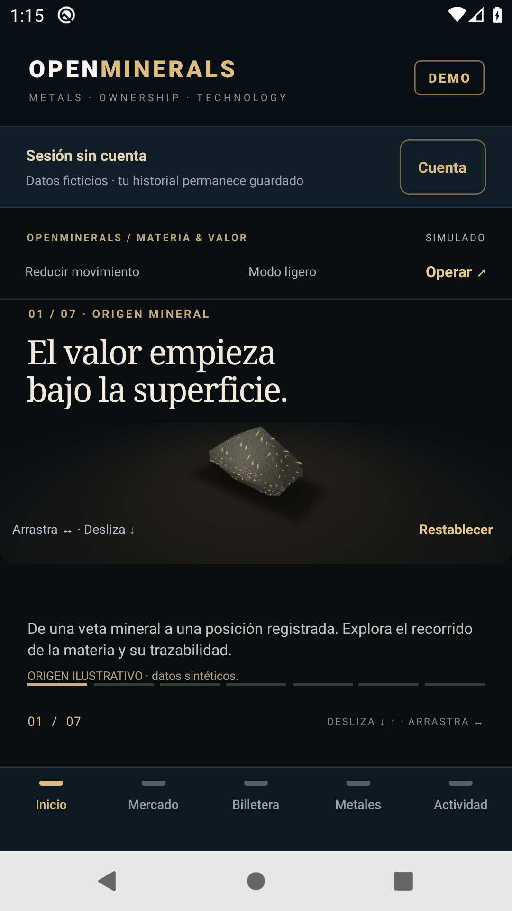
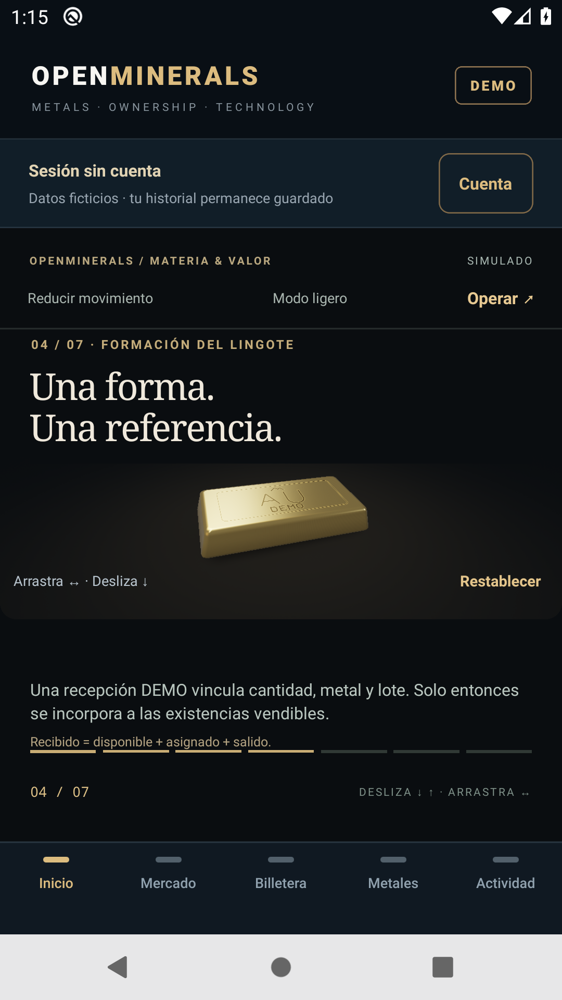
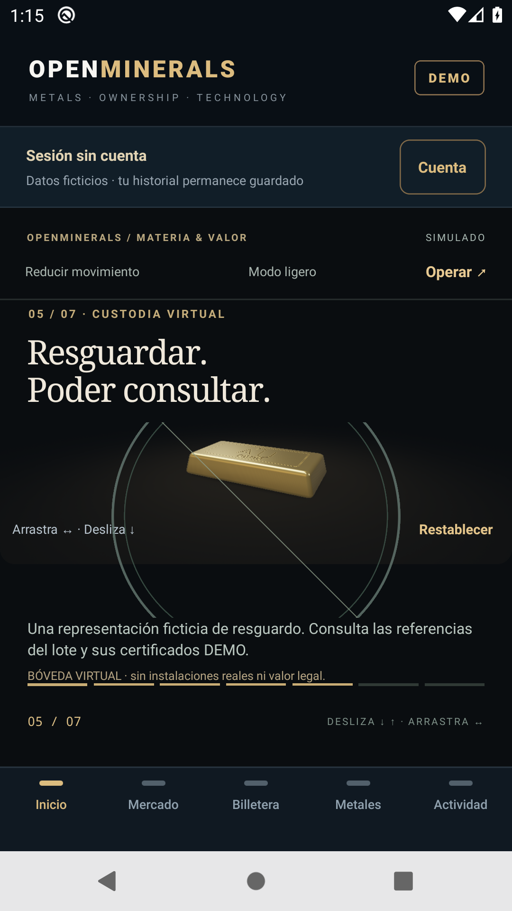
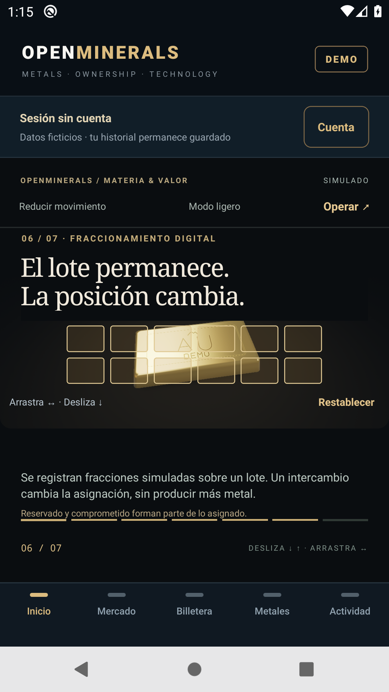

# Sprint inmersivo Android · 30 de octubre de 2026

Checkpoint funcional publicado para demostración y pruebas: **funcional probado; composición de Inicio en nueva revisión; aceptación visual no alcanzada**. Todas las cuentas, cotizaciones, transacciones, reservas, lotes y entregas siguen siendo **ficticios**. La aceptación del sprint permanece abierta: publicar una OTA o aprobar pruebas de software no acredita rendimiento ni aceptación del diseño.

## Fuente y continuidad del trabajo

Se revisó `main` `ad78797` antes de ampliar el proyecto. Ya incluía el trabajo del [informe anterior](19-evolucion-inmersiva-android.md); se conservaron esos avances y se integraron once commits existentes hasta `d9b362e`, sin reemplazar React Native/Expo ni reconstruir la aplicación desde cero.

| Referencia | Fuente de esta revisión |
| --- | --- |
| Repositorio | [Blaister9/Openminerals](https://github.com/Blaister9/Openminerals) |
| Rama publicada | `codex/immersive-custody-20261029` |
| Revisión | [PR #7](https://github.com/Blaister9/Openminerals/pull/7) |
| API, inventario y proyección pública | [89c38d4](https://github.com/Blaister9/Openminerals/commit/89c38d438ed692c87cb01c36d3b669918bff4ccd) |
| Cliente, restauración GL y pruebas Android | [62937b6](https://github.com/Blaister9/Openminerals/commit/62937b63207417d4658fb7f9fa90465709b01feb) |
| Corrección posterior de recuperación de ingresos | [fe37dd1](https://github.com/Blaister9/Openminerals/commit/fe37dd1efd500071973b337ec5eedc75ee7ac20a) |
| Carpeta local de trabajo | `%USERPROFILE%\Projects\Openminerals-immersive-20261030` |

Los informes 14, 16, 18 y 19 se conservan como evidencia de sus propias revisiones; sus resultados no sustituyen los de esta fuente. Este sprint excluye iOS, blockchain y cualquier operación financiera real.

## Inventario, recepción y conciliación

Se corrigió una creación de minas que heredaba cantidades predeterminadas para los metales omitidos. Ahora una mina nueva sin `initialInventoryMg` empieza con **cero en los cuatro metales y sin lotes**. Si se declara un saldo inicial parcial, únicamente se acreditan las cantidades DEMO explícitas. No se reinician minas existentes, cuentas, saldos ni sesiones anteriores; el saldo ficticio previo permanece identificado como saldo inicial.

| Magnitud | Significado dentro de la simulación |
| --- | --- |
| Producido DEMO | Declarado por operador, todavía sin verificación; no se puede vender. |
| Pendiente de verificación | Producción en revisión DEMO; todavía no es stock disponible. |
| Recibido en custodia DEMO | Recepción confirmada que crea un lote y aumenta el suministro una sola vez. El acumulado conserva también los saldos iniciales explícitos. |
| Disponible | Gramos del suministro activo que todavía no están asignados a compradores. |
| Asignado | Posiciones registradas a compradores, con referencia a los lotes de origen. |
| Reservado | Parte de lo asignado inmovilizada por ofertas o solicitudes de entrega. |
| Comprometido para entrega | Subconjunto reservado con cotización aceptada, en preparación o despachado DEMO. |
| Salida por entrega | Reduce suministro activo y asignación; conserva el peso histórico y la trazabilidad del lote. |

Las relaciones comprobadas por metal son:

```text
recibido acumulado − entregado acumulado = suministro activo
disponible + asignado = suministro activo
0 ≤ comprometido para entrega ≤ reservado ≤ asignado
```

Producción y verificación no permiten comprar sin disponibilidad. Las recepciones concurrentes y sus reintentos crean una sola entrada. Vender metal libre respeta las piezas reservadas de cada lote; el intercambio entre compradores transfiere las asignaciones existentes sin aumentar inventario ni suministro físico simulado. El historial conserva entrada, asignación, reserva, liberación, transferencia y salida por lote.

La recepción directa anterior se mantiene como compatibilidad de una recepción DEMO ya verificada. No se usa para ocultar la falta de inventario ni se presenta como producción nueva.

El cliente ya no sustituye compromisos desconocidos por un cero inventado. `parseMineInventory` exige los cinco registros completos, los cuatro metales, cantidades enteras válidas, `reconciled:true` y las relaciones anteriores. Ante datos incompletos o incompatibles, el panel pide actualizar y bloquea la operación que requiere conciliación. El parser de recepción concilia sus lotes pendientes con los totales, valida las salidas y contrasta la masa recibida menos entregada con el suministro. La producción nueva debe caber en la capacidad restante de la simulación, descontando suministro, producción y verificación pendientes.

## Custodia pública y datos operativos

El comprador recibe siempre el nombre **`Mina virtual ficticia DEMO`**, conservando el identificador original de mina. La proyección central se aplica a registro, login, identidad, custodia, certificados, historial de lote, catálogo y entregas. El operador autenticado conserva el nombre operativo. Esto evita que un nombre libre histórico utilizado como dirección se convierta en una etiqueta pública.

Las asignaciones de comprador también utilizan una lista explícita de campos. Metadatos operativos desconocidos que existan en registros anteriores permanecen fuera de ese DTO. Ubicación, documentos, motivos y requisitos operativos se sustituyen por referencias DEMO fijas en las vistas públicas, manteniendo importes, referencias y relaciones originales. Los canarios comprueban que esos textos no aparecen en estado, historial ni comprobantes, además de las rutas de custodia y acceso, tanto en memoria como en PostgreSQL.

El backend comprueba rol y mina para consultar o modificar la operación interna; una pantalla oculta no concede ese permiso. El cliente no incorpora direcciones exactas, coordenadas, planos ni información de seguridad física. Su bóveda es una representación geométrica ficticia. Los DTO de custodia se consultan en memoria y no se persisten como archivo operativo; la persistencia de comandos pendientes conserva lo necesario para resolver sus reintentos.

El significado de las representaciones sigue separado:

- **Lote físico futuro:** requeriría identificación, recepción y verificación fuera de esta aplicación; los lotes actuales son registros de simulación.
- **Fracción registrada:** cantidad entera de miligramos asignada dentro del simulador y relacionada con un lote DEMO.
- **Derecho contractual futuro:** dependería de instrumentos y procesos aún no implementados. Un certificado DEMO o identificador de lote no acredita propiedad, custodia física ni un derecho exigible.

No se emiten tokens ni se ejecutan contratos blockchain. La [planificación documental anterior](15-custodia-documental-y-web3-colombia.md) sigue siendo planificación.

## Inicio continuo y recuperación de la escena

Se mantiene el escenario nativo continuo: origen mineral → extracción → refinación → formación del lingote → custodia → fraccionamiento → portafolio. El desplazamiento controla la progresión visual y permite recorrerla en ambos sentidos; también hay selección de capítulo, omisión y acceso a operaciones con navegación inferior disponible. Monedas y posiciones utilizan navegación horizontal sin reemplazar las confirmaciones comerciales.

Se comprobó primero la instalación existente. El APK 0.2.0 dispone de **ExpoGL y Animated**; no tiene Reanimated, Worklets, Skia, Gesture Handler ni Haptics como dependencias instaladas. Se reutilizan el renderer y Animated existentes, sin nueva dependencia nativa ni WebView. Esta revisión conserva runtime y firma, por lo que su distribución compatible utiliza EAS Update.

Se corrigió la recuperación del contexto gráfico cuando cambia `AppState`: al pasar a segundo plano se detiene la sesión de dibujo y al volver se recrea el contexto, conservando la progresión narrativa. La prueba preparada envía HOME, comprueba segundo plano, vuelve a la actividad con **el mismo PID** y exige escena disponible, etapa conservada y gestos de avance/reversa. Un arranque limpio no cuenta como esa prueba de reanudación.

Continúan el modo ligero sin GL, el movimiento reducido y la lectura accesible. Se revisaron visualmente avance, retroceso y bóveda en una ventana de **390 × 844** del navegador, con API local en memoria y una mina aislada vacía. Esa revisión acredita la interfaz web observada; no demuestra la ejecución ni la fluidez de Android.

## Pruebas ejecutadas

| Comprobación | Resultado de esta fuente | Alcance |
| --- | --- | --- |
| API local sin PostgreSQL configurado | 91 aprobadas; 11 suites PostgreSQL omitidas | Memoria, dominio y HTTP; no se cuentan las omitidas como aprobadas. |
| API completa con PostgreSQL remoto | **170/170 aprobadas; cero fallos y cero omisiones** | 91 de memoria más 79 PostgreSQL, incluidas concurrencia, permisos, privacidad y reapertura. |
| Smoke HTTP original | Aprobado | API local aislada en memoria. |
| Smoke integral HTTP | **964 comprobaciones aprobadas** | Minas y cuentas sintéticas aisladas, API local en memoria. |
| Cliente móvil | **224 aprobadas y dos GL opcionales omitidas** | Lógica y contratos del cliente; las dos omisiones requieren entorno GL. |
| Shaders con Chrome y renderizado de software | **15/15 aprobadas** | Rasterización, continuidad y reversa; separado del resultado móvil y de Android. |
| TypeScript, compatibilidad Expo y toolchain | Aprobados | Conservadas dependencias y módulos instalados. |
| Expo Doctor | **21/21** | Compatibilidad del proyecto; no prueba instalación en teléfono. |
| Android, fuente `62937b6` | **7/7 etapas aprobadas**, incluida reanudación | [Ejecución 41061145241](https://github.com/Blaister9/Openminerals/actions/runs/41061145241). La regresión comercial se registra por separado. |

La suite PostgreSQL se ejecutó por SSH sobre el servicio API del entorno `demo` de Railway, usando el código de `89c38d4` extraído bajo `/tmp`, dependencias existentes mediante symlink y esquemas PostgreSQL aleatorios propios. No se sustituyeron archivos de `/app`, variables del servicio ni datos de la aplicación.

La primera ejecución del arnés tuvo **43 fallos**, todos por el `REQUIRE_DATABASE=true` heredado del servicio: las pruebas deliberadamente en memoria llamaban `createStore('')` y se detenían antes de ejercitarse. Se conservó su log. La segunda corrida usó el **mismo archivo de fuentes verificado**, con `REQUIRE_DATABASE=false` únicamente en el proceso de pruebas y `TEST_DATABASE_URL` asignado desde la conexión remota. Las integraciones continuaron usando PostgreSQL real; aprobaron las 170 pruebas, sin omisiones, en 14,85 segundos. No se relajó la configuración del servicio desplegado.

| Evidencia PostgreSQL local, ignorada por Git | Valor |
| --- | --- |
| Log completo | `artifacts/railway-immersive-pg-89c38d4-20261030-retry-env.log` |
| SHA-256 del archivo de fuentes enviado y verificado | `5a13dee606927cf585de5df440d223d45581ef850635f05c606f6c5acf5406cc` |
| SHA-256 del log final | `133b815286f23a0e90857731cc40113a0a34015c07751b19e7a4d5af31df70f3` |

Los logs privados de ejecución permanecen fuera de Git. Los snapshots de autenticación y las credenciales de los fixtures no se adjuntan al informe.

## Publicación y actualización Android

| Elemento | Referencia |
| --- | --- |
| API pública | [openminerals-api-demo.up.railway.app](https://openminerals-api-demo.up.railway.app) |
| Salud de la API | [/health](https://openminerals-api-demo.up.railway.app/health) |
| Railway | Proyecto `openminerals-demo`, entorno `demo`, servicio API existente y PostgreSQL privado. |
| Nuevo deployment API | `8d5d5f99-047f-45e9-b89d-5176787caadb`, estado `SUCCESS`; HTTPS PostgreSQL, inventario conservado, persistencia y smoke aprobados. |
| Android base conservado | [APK oficial 0.2.0-demo](https://github.com/Blaister9/Openminerals/releases/download/v0.2.0-demo/Openminerals-Demo-0.2.0-android.apk), código 5, paquete `com.openminerals.demo.mobile`. |
| SHA-256 APK | `c35719bf44fdc5a1237249be7e80d6d3102e57ee58f0cd0d9b5af3c66f32d83f` |
| OTA Android vigente | `01a18d19-93f3-767d-bb5b-5e4eeea35cc8`, fuente `fe37dd1` |
| Grupo EAS Update vigente | `70bb91f5-2821-4f75-aa7c-0946810aa3de` |
| Canal/rama y runtime | `demo`, runtime `0.2.0`, fuente móvil `fe37dd1`. |
| Referencia pública de la actualización | [Manifiesto EAS](https://u.expo.dev/update/01a18d19-93f3-767d-bb5b-5e4eeea35cc8) |

No se generó otro APK porque estos cambios reutilizan los módulos nativos instalados. Instalar el APK base no demuestra por sí solo que la OTA ya esté aplicada.

Para instalar o actualizar en Android:

1. Si hace falta el instalador, descargar el APK oficial e instalarlo sobre la versión existente, sin desinstalar ni borrar sus datos.
2. Resolver cualquier operación pendiente antes de actualizar. Con conexión a Internet, buscar la actualización desde Cuenta o Actividad y esperar su descarga.
3. Cerrar y volver a abrir la aplicación cuando no haya operaciones pendientes. Comprobar la revisión **`01a18d19`** antes de evaluar este sprint.
4. En vista comprador o sesión sin cuenta, abrir Inicio, avanzar y retroceder, revisar custodia y fraccionamiento, omitir y entrar a las operaciones. Pasar a otra aplicación y volver; registrar cualquier escena vacía o bloqueo.
5. Para la perspectiva de mina, utilizar únicamente [el acceso público DEMO autorizado](../demo-access/README.md). La cuenta compartida puede cambiar por uso de otras personas. No publicar ni reutilizar claves privadas de compradores o fixtures.

## Evidencia pendiente y criterio de cierre

API verificada después del relevo del contenedor el 30/10/2026: `postgres-demo`, `demoOnly:true`. Los cinco registros de cantidades por metal de la mina existente permanecieron idénticos. Una sesión legacy nueva preparada antes del despliegue conservó estado, comprobante y replay sin duplicación después; el smoke de una sesión ficticia adicional aprobó conversión, compra, venta, oferta y entrega. No se modificaron variables, PostgreSQL ni el origen GitHub configurado en main. La API candidata se publicó por CLI desde el archivo de fuentes `89c38d4`; la PR sigue separada de main. [Evidencia segura del despliegue](evidence/api-immersive-20261030.json).

El escenario anónimo aprobó 7/7 etapas en [41061145241](https://github.com/Blaister9/Openminerals/actions/runs/41061145241). La regresión comercial completa aprobó **23/23 etapas** en [41061954019](https://github.com/Blaister9/Openminerals/actions/runs/41061954019), ambas sobre `62937b6` / OTA `01a18cef`. Incluyó instalación 0.1.3→0.2.0 sin borrar datos, sesión legacy, registro separado, conversión, compra/certificado, oferta/compra entre usuarios, venta, solicitud/cotización/aceptación/ciclo de entrega, reposición, perfil, consulta de fracción y dos conciliaciones API antes/después de las aperturas OTA. Su cobertura comercial nativa corresponde a XAU; la [evidencia comercial estable](evidence/android-commercial-20261030.json) identifica fuente, escenarios, aserciones y límites.

En la mina QA aislada, las aserciones finales comprobaron A: 287,89 USDT / 400 USD / 0,500 g y B: 180 USDT / 600 USD / 0,500 g; disponible 4,500 g + asignado 1,000 g = suministro activo 5,500 g; reservado 0; peso original 6,000 g y entregado 0,500 g. Hubo un solo ingreso de 1,000 g y 4,61 USDT de comisiones ficticias. La transferencia entre compradores conservó el mismo lote. Las cantidades son exclusivamente de fixtures de prueba, no datos del propietario. El artefacto comercial 12981639508 conserva JUnit y controles seguros; el JSON anterior conserva la evidencia estable en el repositorio.

La corrección posterior `fe37dd1`, publicada como OTA `01a18d19`, aprobó **8/8 etapas** en [profile-relaunch 41067695679](https://github.com/Blaister9/Openminerals/actions/runs/41067695679). Un emulador nuevo instaló el APK 0.2.0 y verificó la actualización antes del acceso y tras aperturas en frío con sesión iniciada. Comprobó historial, comprobantes, perfil, fracción XAU y persistencia de acceso con SecureStore, además de las conciliaciones API de los resultados comerciales ya completos. Se conservaron cuentas y saldos sin repetir transacciones ni reiniciar el fixture. La [evidencia estable de actualización](evidence/android-update-20261030.json) registra estas comprobaciones y sus límites: no repite el recorrido comercial completo de `fe37dd1`, no comprueba una migración local 629→fe37 y no ejercita nativamente el camino de pendientes de reposición del operador. Tampoco añade una prueba de narrativa, rendimiento gráfico o aceptación física.

HOME → retorno aprobado sin force-stop: mismo PID, etapa 4 conservada, GL listo y avance/reversa posteriores. Se distingue de las dos aperturas utilizadas para comprobar la OTA. Las comprobaciones del run están en [el JSON nativo](evidence/android-immersive-20261030.json).

Android emulado con KVM y renderizador SwiftShader; corridas únicas, sin grabación salvo el perfil indicado:

| Perfil | Arranque de proceso | PSS antes → después (KiB) | Frames UI janky/total | P50 / P90 / P95 (ms) |
| --- | ---: | ---: | ---: | ---: |
| 3D sin grabar | 1584 ms | 122894 → 122775 | 125/125 | 69 / 250 / 550 |
| Ligero sin grabar | 1211 ms | 112925 → 125560 | 138/139 | 61 / 105 / 450 |
| 3D grabado | 1620 ms | 119576 → 122016 | 101/103 | 105 / 300 / 800 |

El baseline de otra ejecución daba 61/150/300 ms en 3D y 46/73/93 ms en ligero para P50/P90/P95. Los valores actuales son peores: no se atribuye causalidad a un cambio con dos corridas únicas en runners diferentes, ni se declara mejora u optimización completa. El modo ligero existe y funciona, pero esta medición tampoco acredita fluidez en él. Son estadísticas de frames UI, no FPS de GPU; las dos muestras PSS no son memoria máxima ni una prueba prolongada de ausencia de fugas. Arranque no equivale a tiempo completo hasta datos interactivos. Hace falta medir teléfonos físicos.

Capturas Android anónimas del run 41061145241, fuente 62937b6 y OTA 01a18cef. Copias estables en Git; no muestran cuentas privadas ni instalaciones físicas:

| Origen | Lingote | Custodia virtual | Fracciones |
| --- | --- | --- | --- |
|  |  |  |  |

El artefacto público sanitizado 12980765088 contiene además el MP4 anónimo y siete etapas. Su retención es temporal hasta el 31/10/2026; el vídeo no se publica aparte sin revisión. El JSON y las capturas anteriores permanecen en el repositorio. El gesto horizontal fue ejercitado, pero no se midió un ángulo de orientación para atribuirle una aceptación visual precisa. Un exit1 de adb durante el perfil ligero fue gestionado por el arnés y permanece en progress.lastFailure; JUnit y las etapas finalizaron aprobados, sin ocultar ese diagnóstico.

La narrativa, conciliación de inventario, permisos/proyecciones de custodia y recorridos comerciales tienen las verificaciones anteriores por fuente y entorno. Este informe cierra el checkpoint funcional previo: la composición de Inicio requiere una nueva revisión y la aceptación visual no se ha alcanzado. La siguiente composición se documentará en un informe posterior; las pruebas aquí registradas conservan sus fuentes y alcance originales. El rendimiento fluido y la aceptación completa en teléfono siguen pendientes. No se declara custodia real, título legal, emisión blockchain ni validación iOS.

## Revisión de recuperación y QA local

La revisión adicional encontró una respuesta HTTP200 incompleta que podía borrar el pendiente antes de que la vista rechazara un inventario inválido. fe37dd1 alinea las dos guardas de respuestas de operador/stock con parseMineInventory antes de reconocer el comando. Cuatro regresiones HTTP reales contra la API en memoria alteran únicamente la respuesta recibida: compromiso ausente o mayor que la reserva, en recepción y stock. Comprueban archivo durable, cliente reabierto, rechazo de otro comando, misma clave/payload, replay inválido conservado y replay válido que limpia una sola vez, con un único lote/ingreso. Resultado dirigido 38/38; cliente completo 224 aprobadas, 2 GL opcionales omitidas; TypeScript aprobado. Esta corrección no modifica pantallas, módulos nativos ni el renderer; las fuentes de cada ejecución nativa se indican por separado.

La revisión supervisada del export web a 390x844 utilizó API real en memoria, cuentas nuevas y mina vacía en loopback: 0,100 g producido mantuvo disponible 0; verificación mantuvo disponible 0; recepción creó un lote de 0,100 g y habilitó exactamente 0,100 g. La compra de esa fracción dejó disponible 0 y asignado 0,100 g, USDT 235,35 y botón de compra bloqueado por falta de inventario. El historial mostró una entrada y la consulta pública del certificado y los filtros Todos/Paladio funcionaron, con ubicación ficticia fija. Es QA de navegador, no aceptación Android ni medición de rendimiento. No se utilizó la mina compartida del propietario para estas operaciones.
