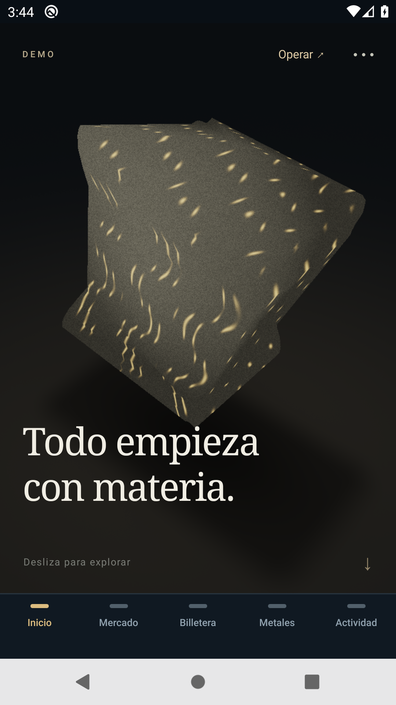
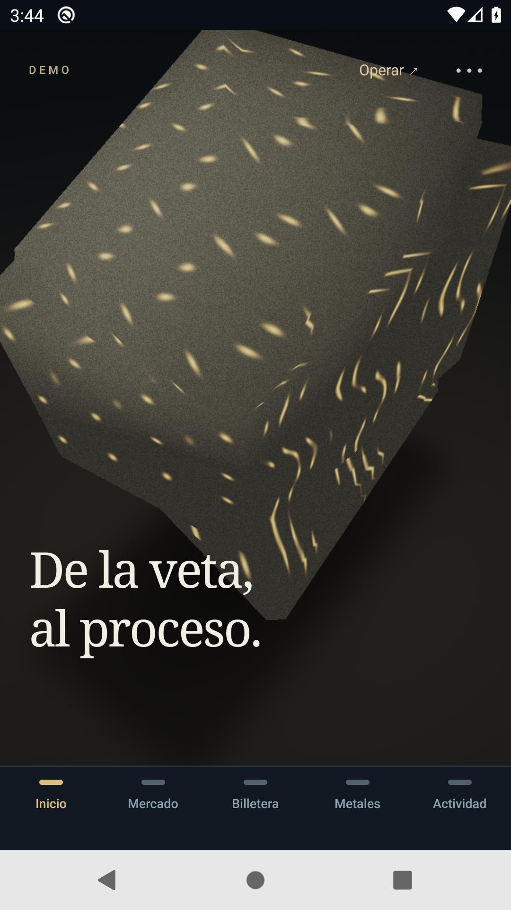
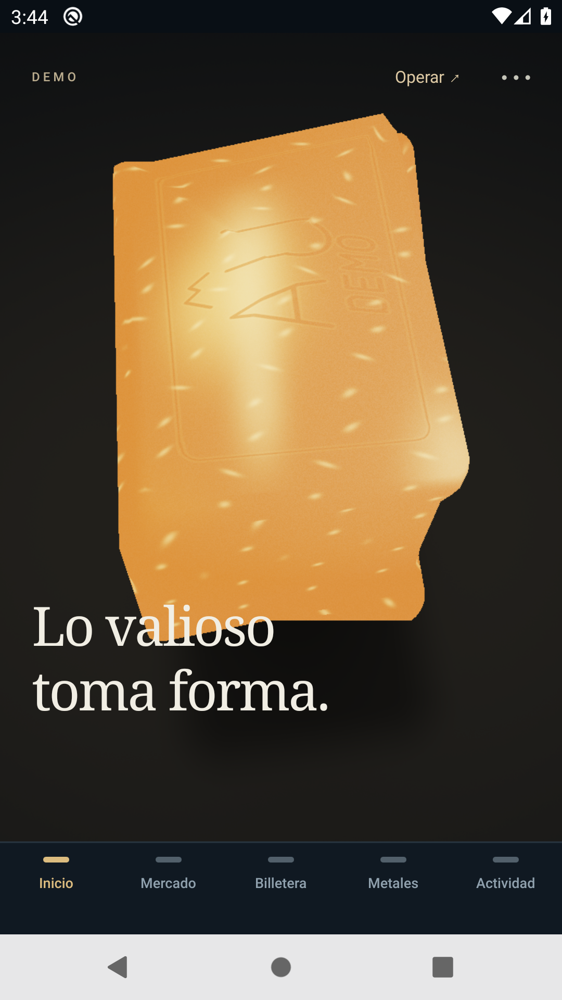
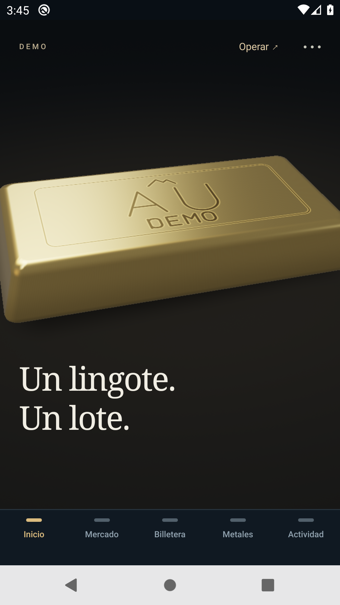
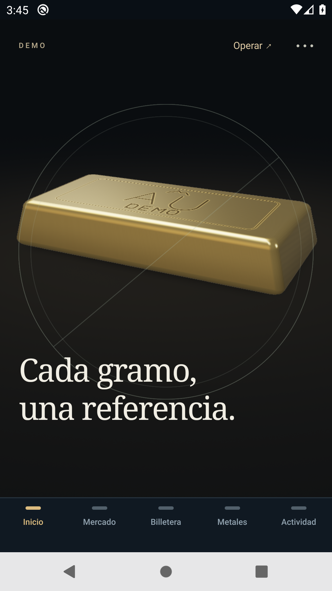
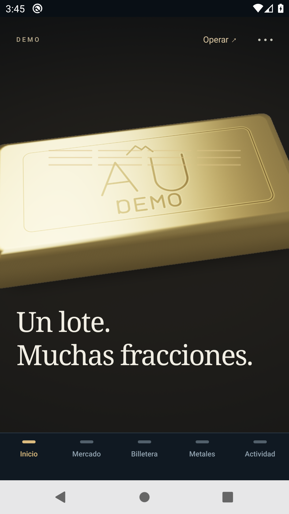
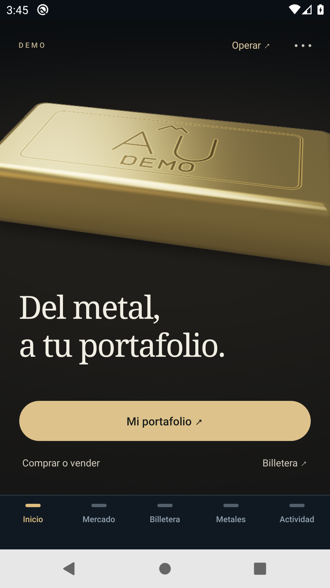
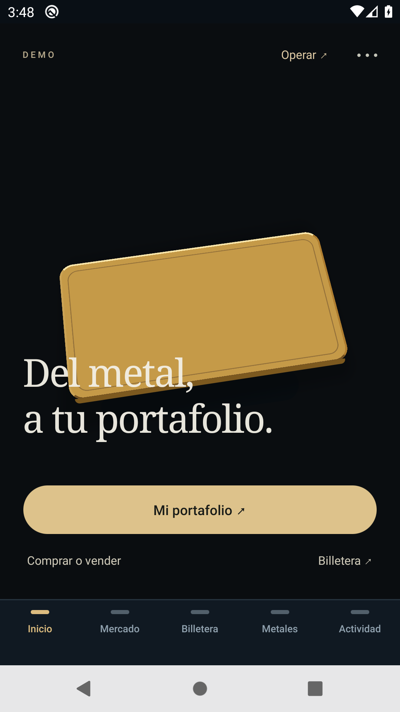

# Inicio inmersivo a pantalla completa · Android

Revisión del 30 de octubre de 2026, fuente [a9ae62e](https://github.com/Blaister9/Openminerals/commit/a9ae62e3095524272bdb3aa4a9ca7478990229aa), rama `codex/immersive-custody-20261029`, [PR #7](https://github.com/Blaister9/Openminerals/pull/7). Carpeta de trabajo: `%USERPROFILE%\Projects\Openminerals-immersive-20261030`.

Esta revisión cambia la composición y la navegación de Inicio. Todo sigue siendo DEMO: saldos, precios, metales, custodia y transacciones ficticios. El alcance es Android; no incorpora iOS, blockchain ni operaciones financieras reales. El propietario confirmó que esta dirección visual mejora y puede conservarse como base.

## Una escena continua en Inicio

Inicio contiene únicamente el escenario narrativo, desde el límite seguro superior hasta la navegación inferior. Su altura procede de la medida real del área disponible, sin sumar otra cabecera ni restar una altura estimada. El contenedor no añade márgenes o rellenos que encajonen el visor.

La cabecera general, la identidad y el aviso de sesión vinculada se consultan en las pantallas de operaciones y Actividad. No ocupan espacio en Inicio. Cuenta continúa accesible desde Actividad; el operador conserva Mina y Cuenta como sus secciones propias.

El recorrido mantiene origen mineral → extracción → refinación → formación del lingote → custodia virtual → fraccionamiento digital → portafolio. El desplazamiento controla la transformación y la cámara, y permite volver atrás. El giro horizontal explora el objeto sin cambiar la etapa. No se introduce un gesto independiente de zoom: los cambios de distancia de cámara pertenecen a la progresión narrativa.

Se retiran el contador visible `01 / 07`, el marco del visor y los controles extensos sobre la escena. El menú de opciones conserva capítulos, movimiento reducido y modo ligero; las etapas mantienen sus etiquetas accesibles. El final coincide con el límite del desplazamiento: no hay una segunda pila de saldos, tarjetas, composición o mercado debajo del relato. Ofrece accesos compactos a Metales, Mercado y Billetera. Operar permite salir hacia Mercado desde el comienzo.

## Acceso contextual y datos conservados

Los accesos del relato seleccionan una pantalla; no envían operaciones. Los bloqueos financieros y las confirmaciones existentes permanecen activos.

| Estado | Comportamiento desde Inicio |
| --- | --- |
| Comprador o sesión sin cuenta disponible | Operar abre Mercado. Los accesos finales abren las pantallas correspondientes. |
| Sesión anterior vinculada o acceso vencido | Inicio no añade otro aviso. El acceso abre el destino y su login contextual. Al entrar como comprador vuelve al destino elegido; un operador sigue entrando en Mina. |
| Operación realmente pendiente | Un aviso compacto superpuesto permite abrir Actividad y resolver el mismo pendiente. No se habilitan movimientos nuevos ni se cambia su clave. |
| Error de consulta | Una acción breve permite reintentar. Los mensajes de vinculación o expiración no se convierten en otro banner sobre Inicio. |

El login normal desde Actividad conserva su recorrido habitual. No se borran sesiones, saldos, posiciones, historial ni comprobantes; tampoco se cambia la vinculación anterior o la separación comprador/operador.

La API continúa con la fuente `89c38d4`, en [Railway/PostgreSQL DEMO](https://openminerals-api-demo.up.railway.app/health). Las **170/170 pruebas API** y la conservación de inventario del despliegue están documentadas en el [checkpoint 20](20-sprint-inmersivo-2026-10-30.md); esta revisión de Inicio no cambia el backend ni vuelve a contar esas pruebas como una ejecución nueva.

## Ajustes de dibujo y legibilidad

El plano de suelo se sitúa por debajo del volumen mineral durante las primeras etapas y vuelve progresivamente a la posición del lingote al formarse. Así evita cortar el mineral como si fuera una lámina. La misma transformación se utiliza al avanzar y retroceder.

La transición del título mantiene una opacidad mínima de **0,88**. Su movimiento es corto y el texto actual sigue legible entre etapas. La escena conserva geometría y shaders propios, ExpoGL y Animated, sin WebView, paquetes ni módulos nativos nuevos.

## Verificación ejecutada de esta fuente

| Comprobación | Resultado y límite |
| --- | --- |
| Cliente móvil | **235 pruebas: 233 aprobadas, cero fallos y dos GL opcionales omitidas** en la suite normal. TypeScript aprobado. |
| Shaders inmersivos con WebGL de software | Formato vertical **360 × 640**, 13 poses distintas y dos retornos: **15 muestras aprobadas** en un contexto. La reversa recupera la rasterización intermedia y original. Es renderizado de software de escritorio, no GPU Android ni prueba física. |
| Interfaz local en navegador | Revisada a **390 × 844** y **360 × 640**: Inicio sin cabeceras, giro horizontal, avance/reversa, final sin contenido extra y acceso final a Billetera. No acredita fluidez ni gestos Android. |
| Sesión vinculada en navegador | Registro con importación y cierre de sesión; Inicio sin aviso de vinculación; Operar abre Mercado y login; el reingreso vuelve a Mercado con **250 USDT ficticios**, sin reiniciar datos. No acredita el mismo recorrido en teléfono. |

Los resultados Android anteriores **7/7**, **23/23** y **8/8** pertenecen a las fuentes del [checkpoint 20](20-sprint-inmersivo-2026-10-30.md). Conservan su valor como evidencia histórica y no sustituyen la ejecución Android de `a9ae62e`.

## Publicación y evidencia Android de esta revisión

| Registro | Estado |
| --- | --- |
| OTA Android publicada | `01a18d53-41bc-7869-9595-9a9b2e3e744c`, grupo `4fc4b9cb-f941-4b00-a7c8-fedead4e5bb7`, 30/10/2026 15:00:06 UTC, UI `a9ae62e`. Prefijo visible `01a18d53`. |
| Recorrido Android anónimo | **7/7 etapas aprobadas**, [run 41082878671](https://github.com/Blaister9/Openminerals/actions/runs/41082878671), harness `07ee442`, UI `a9ae62e`, OTA `01a18d53`. Incluye los siete capítulos, avance/reversa, modos visuales, tres destinos finales y retorno desde HOME con el mismo proceso. |
| Regresión comercial de la interfaz actual | Pendiente de completar. El intento [41087145626](https://github.com/Blaister9/Openminerals/actions/runs/41087145626) se detuvo antes del acceso a las cuentas QA: el saldo legacy de 268,40 USDT se conservó, pero la prueba exigía un texto de composición antes de asegurar la OTA y sin desplazar Metales. No se cuenta como recorrido comercial aprobado. |
| Capturas y vídeo | [Evidencia estable y hashes](evidence/home-native-20261030.json), ocho capturas originales y [vídeo Android anónimo](evidence/home-20261030-gestures.mp4). |

La dirección visual fue validada para continuar. El rendimiento físico y el recorrido comercial completo de esta interfaz siguen pendientes de verificación. El caso anónimo prueba navegación financiera sin enviar órdenes y no entra en cuentas privadas. Envía gestos horizontales y comprueba que no cambian el capítulo; no mide el ángulo del objeto en Android.

### Medidas Android de esta composición

Emulador Pixel 2, Android API 29, x86_64, KVM y renderizador de software SwiftShader, cuatro CPU y 4096 MiB de memoria del invitado. Corridas únicas del run `41082878671`:

| Perfil | Arranque Activity (ms) | PSS antes → después (KiB) | Frames UI janky/total | P50 / P90 / P95 (ms) |
| --- | ---: | ---: | ---: | ---: |
| 3D sin grabación | 1349 | 115804 → 114892 | 283/293 | 81 / 200 / 250 |
| Ligero sin grabación | 1332 | 114931 → 119428 | 287/296 | 77 / 150 / 150 |
| 3D grabado | 1587 | 126153 → 119052 | 163/163 | 250 / 650 / 700 |

Los tiempos de frames son lentos en este emulador; no se declara optimización completa ni fluidez en teléfono. Son estadísticas UI, no FPS de GPU. El arranque procede de `am start`, no del tiempo hasta datos interactivos. PSS se toma antes y después, sin medir el máximo. El perfil grabado contiene gestos continuos; los otros dos incluyen comprobaciones de capítulos y menú. Sus cargas difieren, por lo que no aíslan el coste del grabador. El escenario anterior también medía preparación y salidas diferentes: no constituye un baseline controlado para atribuir una mejora o regresión de rendimiento a esta pantalla.

### Evidencia visual nativa

Las imágenes son capturas originales del run aprobado, no cuadros extraídos de un vídeo. No contienen cuentas privadas, direcciones físicas ni instalaciones reales.

| Origen | Extracción | Refinación | Lingote |
| --- | --- | --- | --- |
|  |  |  |  |

| Custodia | Fracciones | Portafolio | Movimiento reducido |
| --- | --- | --- | --- |
|  |  |  |  |

El [MP4 original](evidence/home-20261030-gestures.mp4), de 73,0095 segundos, muestra avance, retroceso y llegada al portafolio. Incluye una pausa inicial aproximada de 12 segundos de la prueba. Su codificación es de frecuencia variable y el promedio de cuadros codificados no representa los FPS de renderizado. El proceso grabador permaneció activo hasta completar la secuencia. Las copias en Git conservan evidencia aunque caduque el artefacto temporal de Actions.

## Actualizar e instalar

Se conserva el [APK firmado Android 0.2.0, código 5](https://github.com/Blaister9/Openminerals/releases/download/v0.2.0-demo/Openminerals-Demo-0.2.0-android.apk), la firma, el canal `demo` y el runtime `0.2.0`. Esta revisión compatible no necesita otra compilación nativa.

1. Si ya está instalado 0.2.0, conservarlo. Si hace falta el APK, instalarlo como actualización sobre la versión existente, sin desinstalar ni borrar datos.
2. Resolver cualquier operación pendiente antes de aplicar una actualización. Abrir **Actividad → Buscar actualización**; el operador dispone de la actualización desde Cuenta.
3. Esperar la descarga y cerrar y volver a abrir completamente cuando no haya operaciones pendientes. El prefijo esperado de esta revisión es **`01a18d53`**; no usar `01a18d19` como prueba de la nueva composición.
4. Comprobar el indicador **Actualización aplicada** con el prefijo publicado. Recorrer Inicio en ambos sentidos, abrir el menú y probar los accesos finales; consultar saldos e historial en sus pantallas.
5. Si la sesión anterior está vinculada, Operar solicita el acceso correspondiente. Utilizar el alias y la clave propios de demostración; no crear otra cuenta para recuperar la misma sesión ni introducir datos reales.

Este documento distingue la dirección visual validada, las siete etapas nativas aprobadas y las comprobaciones comerciales y de rendimiento físico pendientes. No declara cerrada la optimización de rendimiento.

El bundle Android publicado se comprobó con destino HTTPS Railway y sin el origen local de QA `127.0.0.1:8090`; SHA-256 `b5599569dad3dd2500447e492ce5d4677b222d02e246a382793c24f62a7500be`. Esto comprueba la configuración incluida; no sustituye la comprobación nativa de las operaciones.

## Realismo de la mina: siguiente prioridad visual

La siguiente mejora priorizada es una representación de mina ficticia con más volumen, profundidad y realismo de materiales e iluminación. La composición actual se conserva como base. Se evaluará el coste en Android de cada mejora utilizando el renderer y los componentes existentes antes de incorporar otra tecnología; inventario, permisos y referencias DEMO siguen siendo los mismos registros del simulador.

## Incidencia de la primera ejecución nativa

[41079287567](https://github.com/Blaister9/Openminerals/actions/runs/41079287567) terminó con tres etapas aprobadas y una fallida. El recorrido gráfico y el vídeo habían terminado; la prueba de salida a Mercado buscaba el botón de compra tras centrar únicamente el campo de gramos, dejando el botón fuera de pantalla. El diagnóstico confirmó Mercado seleccionado y la app en primer plano sin error JS/fatal. Se corrigió el desplazamiento de la prueba en `07ee442`, conservando la aserción y añadiendo las comprobaciones de las otras dos salidas. No se cambiaron UI ni operaciones. [La repetición 41082878671](https://github.com/Blaister9/Openminerals/actions/runs/41082878671) aprobó las siete etapas con esa corrección y la misma OTA. Sus capturas, vídeo y métricas son los publicados en este informe.
