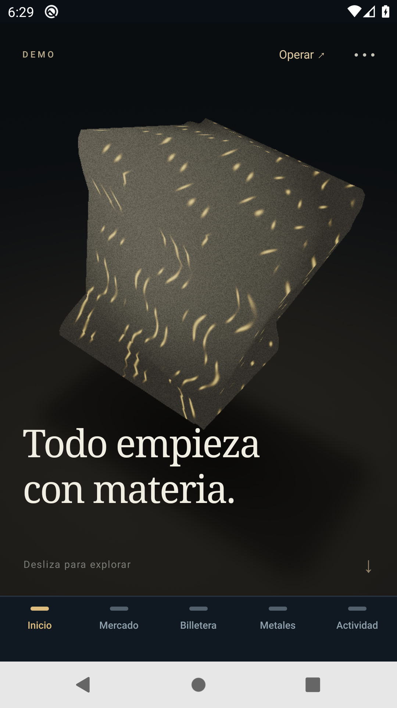
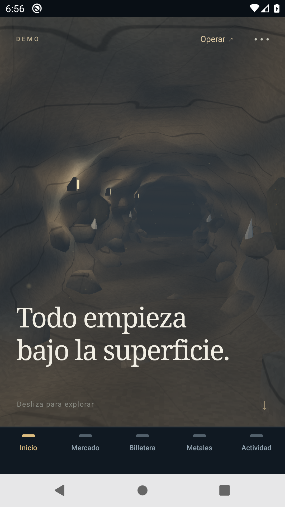
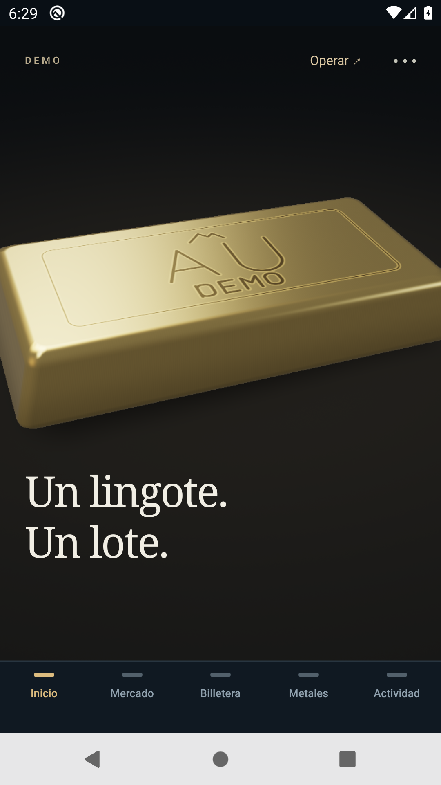
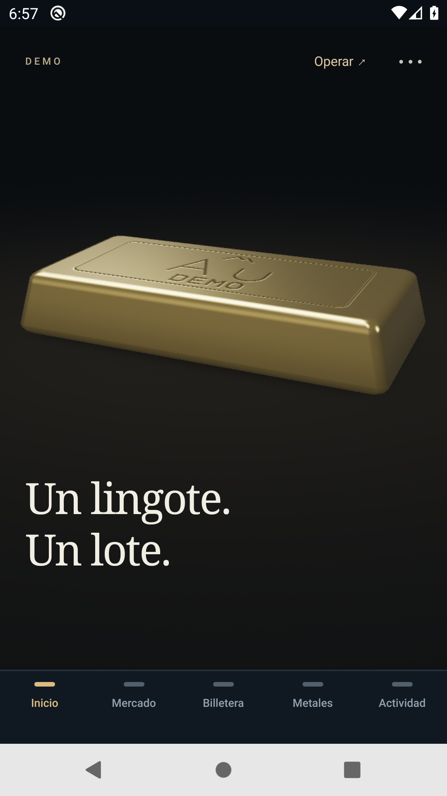
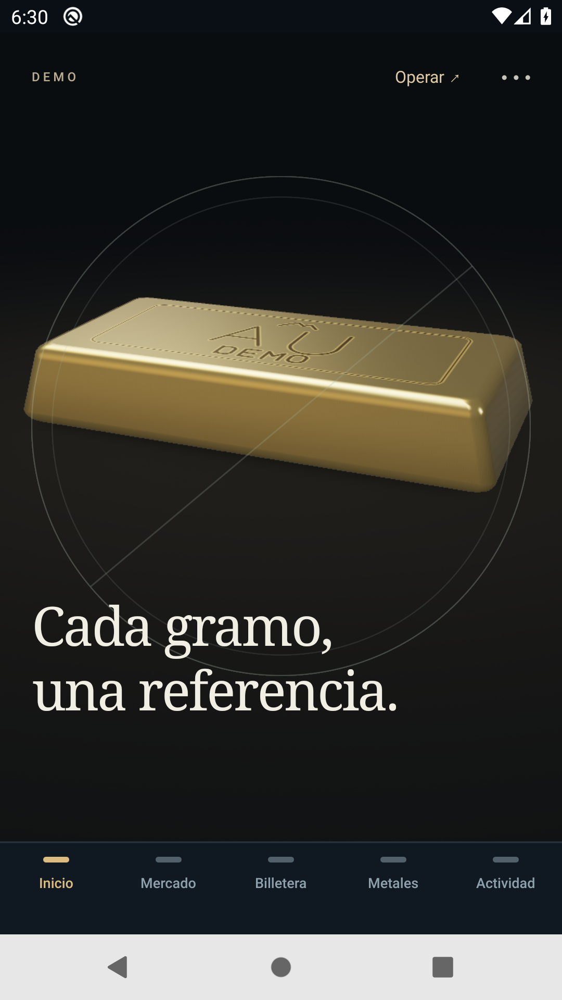
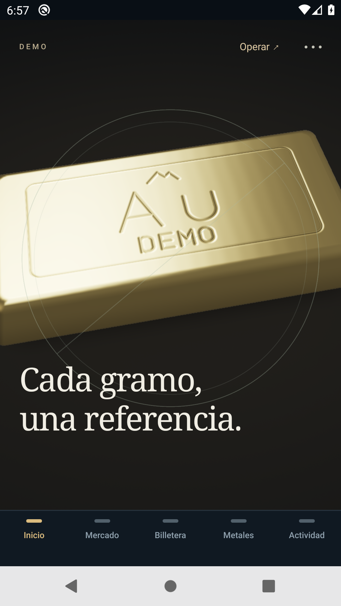

# Realismo geológico · Android

**Estado: candidata verificable; rendimiento físico y aceptación estética pendientes.** Los resultados de software, emulador y teléfono se distinguen. La mina es una representación ficticia DEMO.

## Fuente y distribución

Se revisó la [PR #7](https://github.com/Blaister9/Openminerals/pull/7): su cabeza `3e31bdd` no estaba integrada en `main` (`ad78797`). La [PR #8](https://github.com/Blaister9/Openminerals/pull/8), rama `codex/geological-realism-android-20261030`, se apoya en `codex/immersive-custody-20261029`, sin sobrescribir ese trabajo ni fusionar automáticamente en main. El Inicio aceptado corresponde a `a9ae62e`, OTA `01a18d53`; su evidencia histórica se conserva en el [informe 21](21-inicio-inmersivo-pantalla-completa.md).

| Revisión | Fuente y alcance |
| --- | --- |
| Medición anterior | `8616a58`: solo arnés; conserva la aplicación anterior. |
| Primera candidata geológica | `c2eaaae`: escena, materiales y selección nativa. OTA `01a18e27-57a7-7069-aa2d-c0e7ca0d118b`, grupo `19551e14-0fc2-4abb-b0b3-de3e713d1720`, 30/10/2026 13:51:45 Bogotá. |
| Pruebas del componente real | `18e8f8b`: solo pruebas de adaptación y callbacks obsoletos. |
| Optimización | `39b0f569`: imagen precalculada ligera, retirada del fallback bajo GL listo y mezcla con alfa opaca. **OTA `01a18e58-e304-79e3-9917-7c6d407b9e29`, grupo `38f9c8f3-1193-4b5f-932d-ec2fa7824e95`, 30/10/2026 14:45:52 Bogotá (19:45:52 UTC), runtime `0.2.0`, canal `demo`. Hermes de 1.655.360 bytes, SHA-256 `82e7ce6757b400f5885bd3ef383ddbbd74d0c7f148feaa2040d9332b4b6fdec3`. Hashes Hermes y PNG coinciden con el manifiesto público; no se solicitaron sus URLs CDN.** |
| Último arnés | **`06643bf913983fff5670fcc145b47229f36d8d5d` (solo seis archivos e2e/tests, runtime idéntico a `39b0f569`)**; conserva exactamente la traza medida y añade una captura anónima del túnel ligero antes de medir. |

La API [Railway HTTPS](https://openminerals-api-demo.up.railway.app/health), PostgreSQL, precios, permisos y módulos financieros no cambian en este sprint. La fuente API desplegada sigue siendo `89c38d4`. No se desarrolla iOS, blockchain ni transacciones reales. No se añaden dependencias, motores, WebViews, módulos nativos o permisos. Toda recepción, existencia, precio, saldo, custodia y entrega es ficticia.

## Escena y continuidad

Se conserva el Inicio a pantalla completa sobre la navegación inferior: sin cabecera de cuenta, aviso de vinculación, contador permanente o tarjetas comerciales debajo. Continúan Operar, omisión, capítulos y destinos a Metales, Mercado y Billetera. Las guardas de cuenta, sesión vinculada, acceso vencido y operaciones pendientes permanecen.

El dedo controla avance y retroceso de **Mina → Extracción → Procesamiento → Refinación → Formación del lingote → Custodia virtual → Fraccionamiento digital**. El cierre mantiene el acceso al portafolio. No son siete pantallas autónomas: cámara, profundidad, visibilidad y transformación comparten progreso. La muestra surge como un sólido y se convierte en lingote, con encuadres recuperables al retroceder. La selección de metal utiliza la selección comercial existente; no coloca órdenes ni crea inventario.

El túnel de geometría propia incorpora paredes, techo y suelo desplazados; normales geométricas, variación de estratos, protuberancias ancladas, roca suelta, mineral escaso, cuatro luminarias cálidas y 48 motas. La oclusión por vértice es una aproximación precalculada. No se utilizan mapas de sombras dinámicas ni instalaciones, coordenadas o procedimientos de seguridad reales.

Es una interpretación procedural: las capturas aún muestran facetas, cuarzos triangulares y luminarias simplificadas. No se presenta como fotogrametría o fotorealismo. La narrativa común tampoco afirma que los cuatro metales sigan el mismo proceso industrial.

## Materiales y presupuesto gráfico

`metal-materials.ts` define Au, Ag, Pt y Pd. Los shaders añaden bordes redondeados, reflexión controlada, cepillado suave e incisiones con símbolo y **DEMO**. Oro es amarillo; plata, platino y paladio son blancos neutros, diferenciados también por grabado y selección. Sus acabados RGB/rugosidad son presets ilustrativos, no constantes ópticas, ensayos de pureza o identificación química. Referencias primarias: [oro](https://periodic-table.rsc.org/element/79/gold), [plata](https://periodic-table.rsc.org/element/47/silver), [platino](https://periodic-table.rsc.org/element/78/platinum), [paladio](https://periodic-table.rsc.org/element/46/palladium).

Se conserva ExpoGL con un contexto y dos programas. Los buffers se crean por contexto; progreso, cámara y material cambian sin reconstruir mallas por cuadro. El renderer compartido de `scene-renderer.ts` es el que utiliza Android y el que rasterizan las pruebas de software.

| Geometría máxima simultánea | Triángulos |
| --- | ---: |
| Mina y detalles | 5.926 |
| Espécimen subdividido | 1.600 |
| Suelo del espécimen | 2 |
| Máximo durante el solape | **7.528** |

Son 613.128 bytes de atributos en cinco buffers y hasta tres draws; el suelo invisible se omite. El lingote no cinematográfico conserva 400 triángulos. Estas cifras no miden FPS ni coste por píxel. Se registran y liberan recursos incluso ante construcción parcial fallida.

## Modo ligero y ciclo de vida

La primera candidata mantenía varios arcos y rocas con Views. La medición detectó una regresión; `39b0f569` los sustituye por una sola `Animated.Image` local y conserva el lingote 2D. Su opacidad depende del mismo scroll, sin cámara autónoma ni bucle ocioso. Movimiento reducido permanece respetado. El fallback completo se desmonta tras enviar el primer cuadro GL; vuelve durante preparación/error o al elegir el modo ligero. La mezcla separada conserva alfa 255 en el framebuffer y evita depender de un fondo duplicado durante los fundidos.

El [PNG ligero](../mobile/assets/geology-light.png) procede del renderer propio, pose fija: **360 × 640**, **305.228 bytes**, RGBA base **921.600 bytes**, SHA-256 `31bd3f771fbb5475089c14cbaf7c612d73d6cbd5e93a3d7ce83e048ef9e8a755`. [Su metadata](../mobile/assets/geology-light.json) registra las seis fuentes normalizadas a LF. No es una fotografía ni acredita ejecución Android por sí solo. `cover` puede recortar laterales según la proporción.

Se reproduce con `node mobile/scripts/bake-geology-light.mjs`, definiendo `OPENMINERALS_WEBGL_BROWSER` con la ruta del Chrome de pruebas. El script usa el renderer real y no reemplaza el asset si falla la rasterización. Las pruebas verifican hash, fuentes, dimensiones y presupuesto; comprueban alfa opaca en 18 poses.

El scheduler admite 60 como objetivo inicial y dibuja por demanda. Un coste sostenido de envío superior a 20 ms puede bajar a presupuesto 30 y escala 0,75; si sigue siendo alto puede pasar a ligero. Es una heurística CPU de envío, no medición GPU. La preparación, errores, callbacks obsoletos y cambio de material conservan sus guardas. La app está configurada en vertical; no se afirma prueba de paisaje, TalkBack físico ni texto ampliado.

## Pruebas

| Verificación | Resultado y límites |
| --- | --- |
| Local, fuente final con arnés | **294/294 aprobadas**, cero omitidas, fuente `06643bf`, con los cinco GL opcionales activos en Chrome/SwiftShader y concurrencia dos; TypeScript aprobado. La suite anterior `39b0f569` aprobó 291/291; no se suman resultados superpuestos. |
| CI fuente optimizada | [41115911014](https://github.com/Blaister9/Openminerals/actions/runs/41115911014) y [41115898389](https://github.com/Blaister9/Openminerals/actions/runs/41115898389): **286/286 aprobadas y cinco WebGL opcionales omitidas**, 291 totales. Tipos, dependencias, toolchain, auditoría y Expo Doctor **21/21** aprobados. Los dos runs repiten la suite; no se suman como casos distintos. |
| Backend CI, sin modificaciones | 91 casos aprobados y 11 omitidos en la etapa general; PostgreSQL obligatorio **80/80**, incluyendo un caso de recuperación en memoria ya contado. Son **170 casos distintos** aprobados entre las dos etapas. Es una base CI desechable. |
| Renderer y controles | Trece progresiones distintas, dos retornos exactos y cuatro materiales; presupuesto máximo, alfa opaca y limpieza real de WebGL. Dieciséis pruebas del mock cubren construcción parcial, mezcla y liberación; siete usan los cierres reales del componente extraídos por AST para adaptación/readiness/sesiones obsoletas con reloj y draw simulados. No equivalen a una GPU física. |
| Android anterior | **7/7** en [41106807655](https://github.com/Blaister9/Openminerals/actions/runs/41106807655), UI `a9ae62e`, arnés `8616a58`, OTA `01a18d53`. |
| Android C2 visual | **8/8** en [41110591606](https://github.com/Blaister9/Openminerals/actions/runs/41110591606), fuente y arnés `c2eaaae`, OTA `01a18e27`. Materiales con selección exclusiva, frame GL listo, menús cerrados y Au restaurado antes de finanzas. |
| Android C2 comercial | **24/24 aprobadas, cero fallos, 2.340,320 segundos de etapas**, [41111642553](https://github.com/Blaister9/Openminerals/actions/runs/41111642553), XAU, fixture privado nuevo. |
| Android optimizado visual/comercial | **EN EJECUCIÓN: [visual 41119063468](https://github.com/Blaister9/Openminerals/actions/runs/41119063468), ocho etapas, y [comercial XAU 41119079540](https://github.com/Blaister9/Openminerals/actions/runs/41119079540), 24 etapas. App39, arnés06643bf, OTA01a18e58. Fixture nueva; C2 aprobado no se atribuye a esta optimización**. |

El arnés final `06643bf` aprobó [41118442401](https://github.com/Blaister9/Openminerals/actions/runs/41118442401) y [41118433891](https://github.com/Blaister9/Openminerals/actions/runs/41118433891): **289 aprobadas y cinco GL opcionales omitidas, 294 totales**; Doctor 21/21 y todos los gates aprobados. Sus **54 pruebas dirigidas** de e2e/privacidad aprobaron, con superposición respecto a la suite; no se suman a ella.

El [registro CI](evidence/geology-core-verification-20261030.json) detalla fuentes y jobs. API y móvil conservan sus árboles de dependencias/configuración. Auditoría: API cero avisos; móvil siete bajos, ninguno alto/crítico; no se afirma cero vulnerabilidades móviles. La [regresión comercial C2](evidence/geology-commercial-c2-20261030.json) registra los 24 escenarios, lotes y conciliación antes/después de cold OTA. No inyectó una repetición de la misma clave o pérdida de respuesta: ese alcance pertenece a pruebas backend y cliente separadas. XAG/Pt/Pd se comprobaron visualmente, pero el comercio nativo de esta fixture cubre XAU.

## Medición comparable

Los perfiles mantienen entrada, viewport 1080 × 1920 y recursos configurados: host Ubuntu con cuatro CPU/15.983 MiB, emulador Pixel2 API29 x86_64, cuatro CPU/4.096 MiB, KVM/SwiftShader. Es una muestra por condición en runners compartidos, sin verificar idéntico host físico.

La ventana excluye menús, preparación, capturas y aserciones. Son 15 gestos: tres avances, cuatro retrocesos y ocho avances, cada swipe solicitado de 1800 ms y 250 ms de asentamiento. Especificación SHA-256 `1a48933715ea7e75cfb38bbd45807fd8350da58c3513d6d7666c4f170c85ac9a`; traza compilada `0e30040ccbf227ed1328ee314a4968da933464450aaca3ce8021981db201c8b3`.

| Perfil | Anterior P50/P90/P95 UI, ms | C2 P50/P90/P95 UI, ms | Optimizado |
| --- | --- | --- | --- |
| 3D sin grabar | 200 / 500 / 500 | 200 / 500 / 550 | **En medición** |
| Ligero sin grabar | 57 / 73 / 81 | 73 / 150 / 150 | **En medición** |
| 3D grabado | 250 / 600 / 650 | 250 / 650 / 750 | **En medición** |

La regresión ligera C2 es un resultado observado, no un éxito de optimización. Motivó retirar Views y overdraw. **La optimización aún requiere medición propia: su menor cantidad de Views no basta para afirmar una mejora Android.**. El JSON comparativo conserva las tres revisiones, muestras PSS, arranque y procedencia de los originales.

La comparación evalúa experiencia adaptativa con la misma entrada; no aísla GPU a resolución fija. `automaticLight=false` solo descarta pasar a Views: no registra el nivel intermedio o las dimensiones GL y no acredita 60 FPS. Estadísticas HWUI, número de cuadros codificados VFR y presupuesto del scheduler tampoco son FPS GPU. `am start` mide arranque de Activity con OTA cacheada, no tiempo completamente interactivo. PSS antes/después no es pico ni prueba de ausencia de fugas; batería, temperatura y latencia física no se midieron.

**Samsung S23 Ultra:** el propietario pospuso conexión física. No se vuelve a solicitar USB ni se intenta conexión inalámbrica. Fluidez física, 60 FPS y aceptación estética permanecen pendientes.

## Capturas y grabaciones

**Las capturas y vídeos siguientes corresponden a la base y a C2, no a39. La captura del túnel ligero y los originales optimizados se incorporarán cuando termine su run.

| Momento | Inicio anterior | C2 geológica |
| --- | --- | --- |
| Mina |  |  |
| Lingote |  |  |
| Custodia ficticia |  |  |

[Vídeo anterior original](evidence/geology-before-20261030.mp4) · [Vídeo C2 original](evidence/geology-after-20261030.mp4). Materiales C2: [Au](evidence/geology-metal-XAU-20261030.png), [Ag](evidence/geology-metal-XAG-20261030.png), [Pt](evidence/geology-metal-XPT-20261030.png), [Pd](evidence/geology-metal-XPD-20261030.png). [Comparación y procedencia](evidence/geology-android-comparison-20261030.json).**. Los archivos publicados proceden de flujos Android anónimos antes de introducir credenciales; se conservan los bytes y tiempos originales, con SHA-256 y procedencia en el JSON. Las imágenes C2 no se atribuyen a la optimización posterior. Lingote y custodia se comparan por significado: etapas anteriores 4/5 frente a nuevas 5/6. DEMO visible en estas poses no acredita legibilidad en todos los tamaños o ángulos.

## Actualizar sin reinstalar

Se conserva el [APK firmado Android0.2.0/código5](https://github.com/Blaister9/Openminerals/releases/download/v0.2.0-demo/Openminerals-Demo-0.2.0-android.apk), paquete `com.openminerals.demo.mobile`, runtime `0.2.0` y canal `demo`. **La OTA optimizada publicada se identifica por **`01a18e58`**; su aplicación nativa se está comprobando en los dos runs indicados**. No hace falta otro APK si ya está instalado 0.2.0.

Resuelve operaciones pendientes; en Actividad o Cuenta pulsa Buscar actualización, espera la descarga y cierra/reabre cuando no haya operaciones pendientes. No desinstales, borres datos o crees otra cuenta para actualizar. `01a18d53` corresponde al Inicio anterior; `01a18e27` a C2. La comprobación nativa de OTA se identifica por su ID real, no por el enlace de la PR.

## Incidencias y límites conservados

Se corrigieron roca inicialmente cúbica/oscura, espécimen translúcido, zona muerta al invertir un arrastre largo, suelo invisible y registro de buffer ante fallo de atributo. La optimización añadió control de alfa opaca y eliminó el fallback duplicado. La falta de telemetría de nivel adaptativo y validación física permanece expresamente abierta.

La primera suite local con todos los Chrome en paralelo activó el timeout existente de diez segundos del parser Python de recuperación. El caso aprobó aislado y la suite completa con concurrencia dos. No se modificaron parser, timeout o módulos financieros. La descarga directa del CDN EAS respondió403: se verificó el hash del export local contra el manifiesto público, sin eludir esa respuesta, y se complementó con aplicación nativa de OTA.

**Las doce credenciales temporales de CI pertenecen a fixtures privadas y se mantienen durante las dos ejecuciones optimizadas; su retiro queda pendiente de terminar ambas**. Las fixtures son minas explícitas de simulación; no reinician la mina pública o las sesiones del propietario. Ninguna credencial privada, token, dato de recuperación o pantalla de cuenta se incorpora a la evidencia pública.
