# Realismo minero Android · sprint del 1 de noviembre de 2026

**En desarrollo. Todo es DEMO.** La candidata de este sprint se instala como aplicación Android independiente para conservar la entrega comercial. R4/código 4 está publicada, fuente `ce9b79b5abbe0389e5f2661dda0d7abc6b53bc14`. Los fallos r1/r2/r3 se conservan con sus resultados. No hay aceptación física ni rendimiento a 60 FPS acreditados.

## Entrega conservada

La base es `main@ed87d2ea233227437ab5f5cc2eb0900674e1231f`. El APK Android 0.3.0/código 6 procede de `eae7f6ad57f5a667c2bf40775a4cb30f1c0dd8b6`: las diferencias posteriores son del arnés de aceptación. [CI de fuentes](https://github.com/Blaister9/Openminerals/actions/runs/41218118564) y [aceptación en emulador](https://github.com/Blaister9/Openminerals/actions/runs/41218121238) aprobaron; esta última incluye comercio, actualización de comprador/operador y cuentas/billeteras. Los artefactos descargables del run ya no estaban disponibles al auditarlo. Esto no acredita aceptación en teléfono.

El [APK 0.3.0 existente](https://expo.dev/artifacts/eas/zzjf0770cQWD12A6J-ly7cuCyZfpwrKet8sKRaWJDZQ.apk), [build EAS `ea0349a4`](https://expo.dev/accounts/chipirips-team/projects/openminerals-demo/builds/ea0349a4-7b55-4808-a332-be290d1a9b9e), conserva paquete `com.openminerals.demo.mobile`, runtime `0.3.0`, canal `demo` y SHA-256 `d99e8af9617f56d7862a849ebd057025cb9d6adc164b97496a5532f7b29ad29e`. No existe una release GitHub 0.3.0 al comenzar este sprint. La [release publicada con APK](https://github.com/Blaister9/Openminerals/releases/tag/v0.2.0-demo) sigue siendo 0.2.0, SHA-256 `c35719bf44fdc5a1237249be7e80d6d3102e57ee58f0cd0d9b5af3c66f32d83f`; la RC posterior remite al mismo binario. No se reemplazan sus archivos ni tags. [Manifest de preservación](evidence/sprint-realism-20261101/stable-release.json).

La [PR geológica #8](https://github.com/Blaister9/Openminerals/pull/8), cabeza `80da7c8`, conserva una implementación y evidencia histórica del 30 de octubre. Se adaptan selectivamente sus módulos gráficos sobre la base comercial actual; no se mezcla su rama ni se incorporan sus contratos o cambios de API. Sus métricas y vídeos pertenecen a Android 0.2.0 y no se atribuyen al nuevo binario.

## Candidata Android aislada

Rama: `codex/android-mine-realism-20261101`. `mobile/app.json` conserva el registro estable; `mobile/app.config.js` resuelve siempre la candidata, también en desarrollo local. Identidad: **Openminerals Mina Preview**, paquete `com.openminerals.demo.minepreview`, versión/runtime `0.4.0`, revisión **r4/código 4**, esquema `openminerals-mine-preview`, canal `mine-realism`. El perfil EAS `mine-realism` utiliza entorno `preview`, APK interno y la misma API DEMO HTTPS.

Se mantienen proyecto EAS, ExpoGL, dependencias y configuración de recuperación embebida. El runtime distinto impide que la candidata se aplique a los APK estables; el canal propio y su cabecera separan además las solicitudes. La configuración rechaza perfiles EAS antiguos, compilación sin el opt-in `OPENMINERALS_MINE_PREVIEW=1` y plataforma iOS. Los perfiles anteriores permanecen como procedencia; para reconstruir la entrega estable se usa su commit congelado.

La instalación paralela conserva la app comercial y sus datos en su propio almacenamiento. La preview comienza con una sesión local nueva; no importa automáticamente SecureStore, saldos ni pendientes de la instalación estable. Una cuenta DEMO existente puede abrirse explícitamente en la preview y sigue viendo su mismo estado de backend. La QA nativa usa una sesión legacy nueva para comercio, un comprador ficticio sin importar y el operador público solo para lectura. El comercio autenticado completo requiere fixtures de mina aislada y queda separado de este protocolo; ninguna medición visual necesita modificar inventario de la mina presentada.

Desde `mobile`, `npx eas-cli build --platform android --profile mine-realism` compila la candidata; el perfil contiene el opt-in. El [build EAS r4 `fec9092b`](https://expo.dev/accounts/chipirips-team/projects/openminerals-demo/builds/fec9092b-2599-4ac3-82f1-dcaae9461bf5) terminó el **1/11/2026 a las 23:27:34 de Bogotá**, fuente `ce9b79b5abbe0389e5f2661dda0d7abc6b53bc14`. Versión `0.4.0`, código 4, mismo runtime y firma de Preview. Se conservan r3 `8d7e18e9`, r2 `aae7fd04`, r1 `8b45cf14` y sus APK como diagnóstico. El build inicial `f1d5867d` se canceló. No se publica OTA sobre `demo`.

[Descargar APK Mina Preview 0.4.0 r4](https://github.com/Blaister9/Openminerals/releases/download/android-mine-preview-0.4.0-r4-20261101/Openminerals-Mina-Preview-0.4.0-r4-android.apk) · [prerelease independiente](https://github.com/Blaister9/Openminerals/releases/tag/android-mine-preview-0.4.0-r4-20261101). APK: **77.361.280 bytes**, SHA-256 `adfbf909f0cf0c924c7b8938a1a773c5c96b84f14f86ae0e8c0bf53b7e1b1bf5`; certificado `86c84db35e91b187f3f818c0cc74ddb91df9a95014cba138ac7e04611957aa09`. `apksigner` y la inspección de manifiesto/bundle aprobaron identidad, runtime/canal, ABIs, ausencia de `debuggable`, recuperación y API HTTPS. El digest del asset GitHub coincide. El certificado se obtiene del artefacto EAS y se fija para cotejarlo en CI; no se afirma consultar independientemente el almacén de credenciales. [Registro del build r4](evidence/sprint-realism-20261101/candidate-build.json) · [r3 archivado](evidence/sprint-realism-20261101/failed-r3-comparison/candidate-build.json) · [r2 archivado](evidence/sprint-realism-20261101/android-r2-comparison/candidate-build.json).

Instalar **Mina Preview** junto a Openminerals Demo, sin desinstalar ni borrar datos de esta última. La copia `Presented-Openminerals-Demo-0.3.0-android.apk` de la prerelease r1, enlazada en el registro del build, sirve de referencia exacta para CI, no es la experiencia nueva. Puede abrirse explícitamente una cuenta DEMO en Preview; su sesión local inicial es independiente. No resolver un pendiente de la app estable cambiando de cuenta o reinstalando.

## Escena y continuidad

La escena pasa de un espécimen flotante a una galería ficticia de más de 40 unidades de profundidad, con techo, paredes y suelo desplazados, normales de superficie, salientes y rocas irregulares, cuarzo opaco y luminarias. Las vetas se evalúan sobre las coordenadas tridimensionales de las paredes. Se utilizan buffers estáticos, ExpoGL y shaders propios; no hay bibliotecas gráficas, SDK ni módulos nativos nuevos.

El túnel emplea BRDF Cook–Torrance con GGX, visibilidad Smith y Fresnel Schlick, rugosidad/metallicidad y energía difusa reducida en las vetas. Dos volúmenes elipsoidales aproximan las sombras de los salientes frente a cuatro luces acotadas. No son mapas de sombras de toda la geometría ni iluminación global. AO de cavidades, niebla y 48 partículas pequeñas completan la atmósfera; su posición sigue el desplazamiento, sin bucle de animación en reposo.

Se conserva el orden y los accesos de los siete capítulos: origen → extracción → refinación → lingote → custodia virtual → fraccionamiento → portafolio. La cámara recorre la galería y el espécimen avanza al primer plano mientras el túnel se disuelve; la geometría se transforma hasta el lingote. Las mismas funciones de progreso se evalúan al retroceder. La selección de Au/Ag/Pt/Pd es estado local de la representación: **no cambia el metal elegido en Mercado**, saldos, permisos ni envía operaciones. `App.tsx`, componentes comerciales, `api/`, dependencias y locks permanecen idénticos a la base.

El scheduler dibuja por demanda. En GPU real/desconocida comienza con presupuesto de 60 y lado físico máximo 1024; tras 12 muestras con p90 de finalización superior a 20 ms pasa a 30 conservando la superficie. Los renderizadores nativos explícitos SwiftShader/llvmpipe/softpipe empiezan equilibrados, a 30 y máximo 384. Tras 24 muestras equilibradas con p90 superior a 40 ms solicita vista ligera. Son presupuestos y umbrales, **no FPS medidos en teléfono**. En nativo, cada dibujo envía `finish → endFrameEXP → flushEXP`: espera la cola y finalización GPU antes de devolver el control; no confirma la presentación posterior mediante `eglSwapBuffers`. El coste incluye CPU, espera de cola y GPU; no mide presentación/compositor ni GPU aislada. La ruta WebGL de escritorio mantiene su envío anterior. El modo ligero usa un bitmap precalculado de 360×640, 314.992 bytes, más el lingote simplificado. Movimiento reducido y lector de pantalla pausan el dibujo/cámara; si GL ya existía, r4 lo conserva bajo la cobertura hasta recrear o abandonar Inicio. Un inicio únicamente reducido no lo asigna. La muestra ligera anterior de PR #8 tenía una regresión: no se supone corregida por equivalencia.

## Validación y pendientes

R4 aprobó **353/353 pruebas móviles locales**, sin omisiones y con shaders de software reales, además de TypeScript. Las 43 dirigidas de ciclo gráfico ejecutan closures extraídos del componente con recursos simulados: ocho pausas/reanudaciones reutilizan un renderer, el modo reducido inicial no asigna GL y timers antiguos no invalidan otro intento. No montan una superficie Android. La superficie mantiene opacidad 1, cobertura hasta frame listo, propiedad de recursos por sesión, reintento automático acotado y recuperación manual. Los fallos `context-timeout`, `create`, `draw`, `boundary` y `unavailable` se distinguen del modo ligero por rendimiento. El arnés de grabación aprobó 36/36 dirigidas incluidas en el total; el cambio posterior de orden aprobó 37/37. [Validación local r4](evidence/sprint-realism-20261101/visual-validation.json) · [r3 archivado](evidence/sprint-realism-20261101/failed-r3-comparison/visual-validation.json).

La creación diferida de la superficie durante el dibujo está documentada en [TextureView de AOSP](https://android.googlesource.com/platform/frameworks/base.git/+/84ddbe542bed39183d84de57bca93d99d7330bc5/core/java/android/view/TextureView.java). Que opacidad cero haya causado el fallo r2 es **una hipótesis**, pendiente del contraste nativo. La barrera síncrona de ExpoGL no tiene timeout nativo; un watchdog JavaScript no interrumpe una llamada nativa bloqueada. No se atribuye el fallo observado a esa barrera. [Revisión de las fuentes nativas instaladas](evidence/sprint-realism-20261101/native-completion-review.json).

La [CI actual r4 `907ccc9`](https://github.com/Blaister9/Openminerals/actions/runs/41393661100) aprobó **170 casos API distintos y 348 pruebas móviles**, con seis GL opcionales omitidas y Doctor 21/21. La suite local ejecutó 353 sin omisiones en `8c4361d`; el arnés posterior aprobó 37/37 dirigidas. APK: `ce9b79b`; fuente de verificación actual: `907ccc9`. [Contadores y jobs actuales](evidence/sprint-realism-20261101/core-ci.json). El caso comercial r4 y la comparación actual se documentan por separado más abajo.

La [CI del arnés corregido `a11bb2a`](https://github.com/Blaister9/Openminerals/actions/runs/41385054870) aprobó **170 casos API distintos y 336 móviles**, con seis pruebas GL opcionales omitidas y Doctor 21/21. La fuente de la APK sigue siendo `0d3fa50`; el SHA del arnés no se atribuye al binario. [Contadores históricos r3](evidence/sprint-realism-20261101/failed-r3-comparison/core-ci.json).

El primer caso comercial nativo r3 [41384249997](https://github.com/Blaister9/Openminerals/actions/runs/41384249997/job/125081454743) falló en el primer flow a los 2,74 s, tras verificar e instalar ambos APK. No se acredita ninguna operación ni autenticación completada. Los comandos nuevos de entrada se cambiaron a la sintaxis establecida `eraseText: 100` y `hideKeyboard` escalar; la causa exacta permanece sin demostrar hasta contrastar la ejecución corregida. Se preserva la [evidencia del caso comercial](evidence/sprint-realism-20261101/failed-r3-commerce-parser/provenance.json), separada de la comparación visual del mismo run.

Las pruebas nuevas de configuración ejecutan el resolvedor real para comprobar identidad local/build equivalente, canal/runtime distintos, preservación de `app.json`, rechazo de perfiles antiguos/opt-in ausente/iOS y URL API HTTPS sin secretos. El 1/11 aprobaron **15/15 pruebas dirigidas**: cuatro nuevas de preview y once existentes de entrega, mediante `node --experimental-strip-types --test test/mine-preview-config.test.mjs test/android-release.test.mjs` desde `mobile`. `npx expo config --type public --json` resolvió la identidad aislada y `git diff --check` aprobó. Estas pruebas no ejecutan Android ni acreditan una compilación nueva.

La validación inicial sobre `ed87d2e` aprobó **91 ejecuciones API en memoria y 80 sobre PostgreSQL 17.4 local desechable**, smoke local y **252 pruebas móviles**, con dos GL opcionales omitidas. Son **170 casos API distintos**: el runner PostgreSQL repite un caso adversarial de recuperación de memoria. TypeScript, compatibilidad Expo, parche de toolchain y Doctor 21/21 aprobaron. [Resultados iniciales](evidence/sprint-realism-20261101/initial-validation.json). No se reinició ni modificó Railway/PostgreSQL compartido.

Comprobación administrativa de solo lectura: proyecto Railway **`openminerals-demo`** (`1442be94-b13f-4067-9fee-ea99caf5715a`), entorno **`demo`** (`1e835541-fd3a-49dd-8ae3-0315d4118940`), servicio **`openminerals-api`** (`00e2d919-2cd1-4293-befd-d8af58df8069`), raíz `/api`, repositorio/rama `Blaister9/Openminerals@main`. API y Postgres están `online`, sin patch pendiente; API conserva despliegue `3e03a496-5765-4ac3-a255-3c6f2439413a` del 31/10. Dominio: [API DEMO](https://openminerals-api-demo.up.railway.app/health). [Registro de estado y configuración](evidence/sprint-realism-20261101/railway-readonly.json). No se consultaron valores de variables, tocaron servicios de `production`, ejecutaron SQL o reinicios administrativos. Las pruebas funcionales usan únicamente registros DEMO nuevos mediante la API existente; no acreditan otra prueba de persistencia tras reiniciar Railway.

La suite local de r2 aprobó **329/329 pruebas móviles**, con Chrome/SwiftShader habilitado y cero omisiones. Incluyen 18 poses del renderer compuesto, reversibilidad exacta, opacidad de la composición, cuatro materiales/estampados, liberación de buffers/programas, recuperación de contextos obsoletos, adaptación real del componente y controles del nuevo harness. El [reporte de software](evidence/sprint-realism-20261101/software/report.json) identifica su entorno de escritorio; no acredita Android. La prueba de iluminación ejecuta 12 comparaciones con/sin sombras y 288 sondas GLSL finitas, incluso con vectores opuestos. El export Hermes Android también terminó con la API pública HTTPS. [Validación gráfica r2 archivada](evidence/sprint-realism-20261101/android-r2-comparison/visual-validation.json).

La simulación del scheduler encontró y corrigió una pérdida de cadencia: el límite de 60 producía 45 dibujos/s a 90 Hz, y el de 30 podía caer a 20,5–26,6. El acumulador de plazos alcanza promedios de 60 y 30 con relojes controlados de 60/90/120 Hz y evita ráfagas tras pausas. Esto verifica el planificador, **no FPS reales de GPU o teléfono**. La escena expone su nivel de calidad para registrar si la medición observa calidad alta, equilibrada o vista ligera.

| Android emulado, mismo run | Origen mineral | Lingote | Custodia virtual |
| --- | --- | --- | --- |
| Estable 0.3.0 | 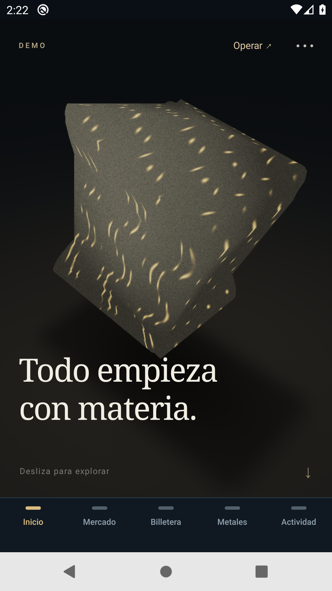 | 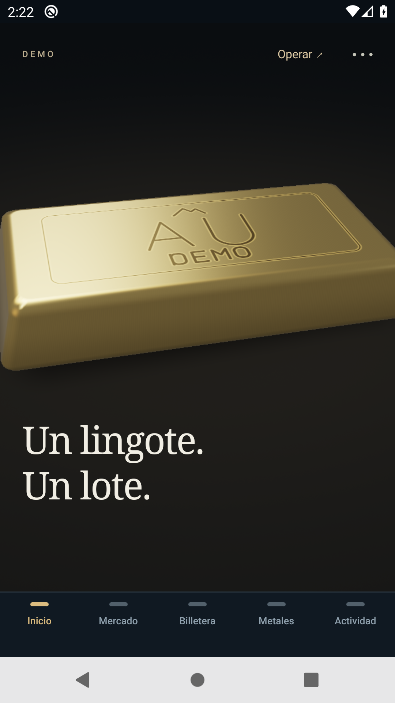 | 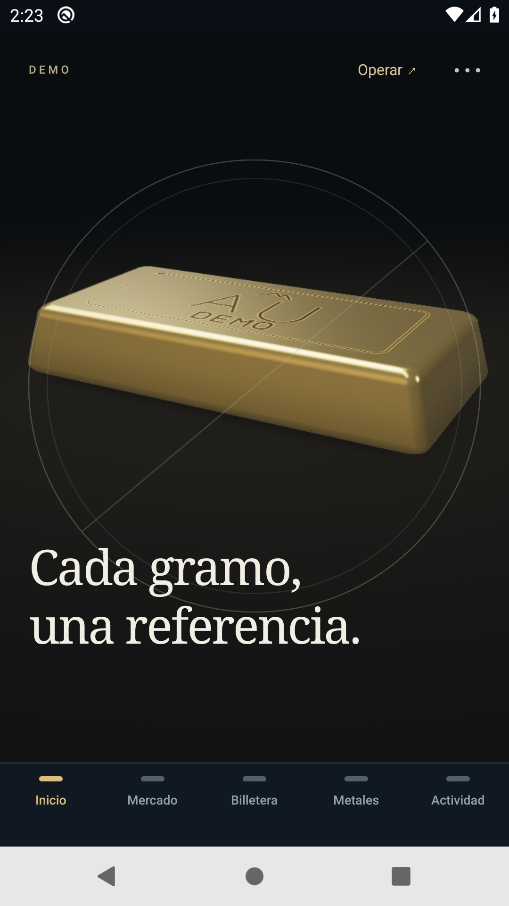 |
| Preview r2, GL equilibrado | 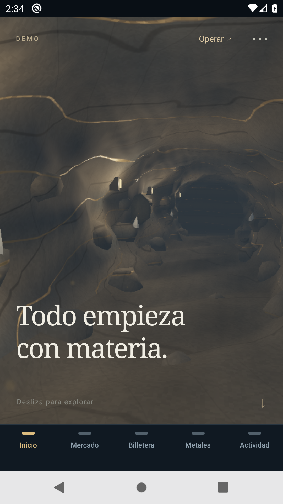 | 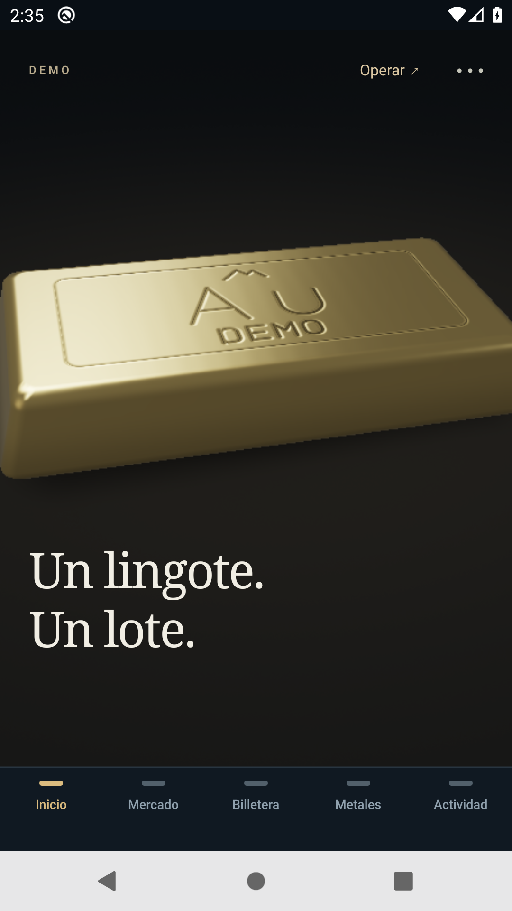 | 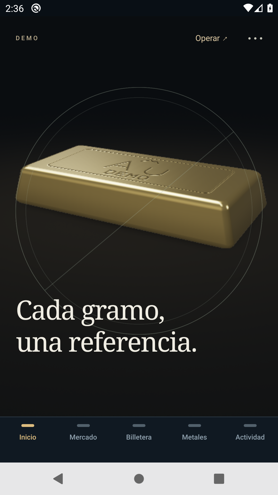 |

Estas filas pertenecen al emulador API29/x86_64/SwiftShader del run r2; las siete capturas nuevas se observaron GL listas y equilibradas, y se revisaron sus píxeles. Son una condición distinta del vídeo adaptativo. El [render de software de escritorio](evidence/sprint-realism-20261101/software/report.json) conserva su identidad y no se atribuye a Android. El [vídeo estable original](evidence/sprint-realism-20261101/baseline/stable-030-tour.mp4), sus hashes y la [procedencia](evidence/sprint-realism-20261101/baseline/provenance.json) se conservan. La muestra histórica mide p50/p90/p95 UI 200/500/550 ms; no es una comparación controlada contra la candidata. El AVD local quedó `unauthorized` antes de ejecutar apps; no se automatizó la autorización, instaló software ni borraron datos. [Limitación local](evidence/sprint-realism-20261101/baseline/local-emulator-attempt.json).

## Comparación Android r4 completada · 2 de noviembre

El [run `41393661195`](https://github.com/Blaister9/Openminerals/actions/runs/41393661195/job/125110302767), arnés `907ccc9`, aprobó **18/18 fases nativas** sobre Android API29/x86_64/SwiftShader. Incluye siete capítulos de cada APK, perfiles ligero/grabado/sin grabar, movimiento reducido, salidas, reanudación GL en el mismo proceso y conservación de UID/versión estable. R4 y la referencia comparten emulador y los mismos 15 gestos por perfil; la candidata se ejecutó primero, sin contrabalancear el orden. [Originales, revisión visual por agentes y hashes](evidence/sprint-realism-20261101/android-r4-comparison/provenance.json).

| Mismo run Android | Origen | Extracción | Custodia virtual |
| --- | --- | --- | --- |
| Estable 0.3.0 |  | 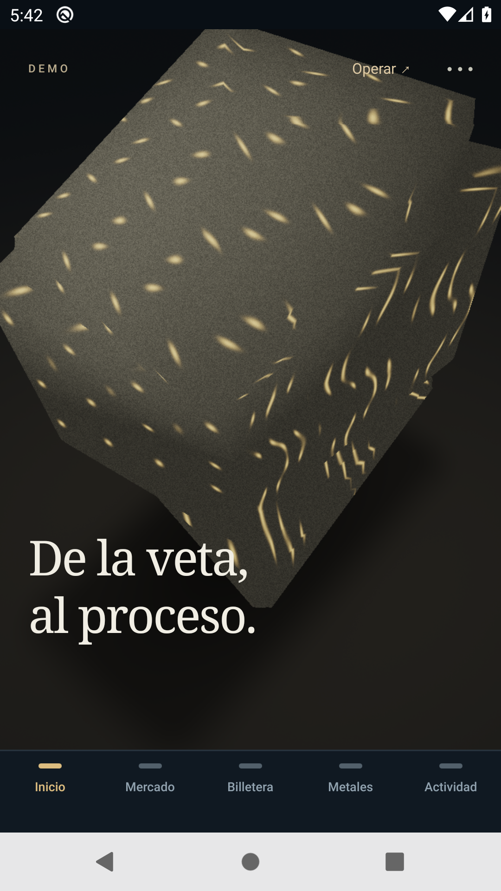 | 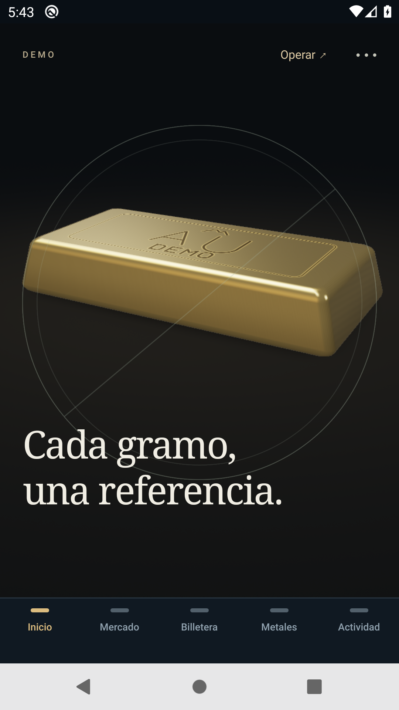 |
| Mina Preview r4, GL equilibrado | 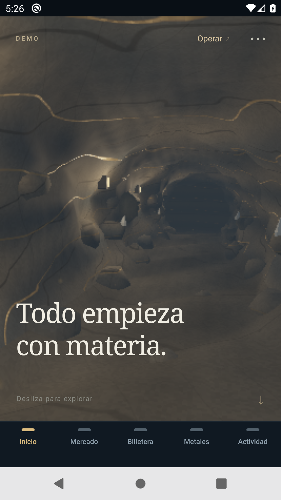 | 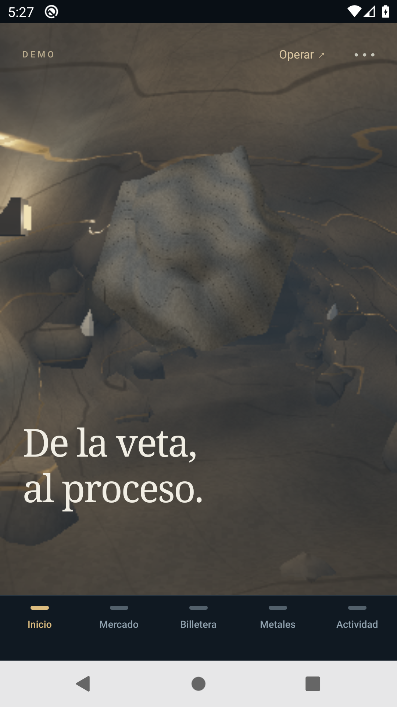 | 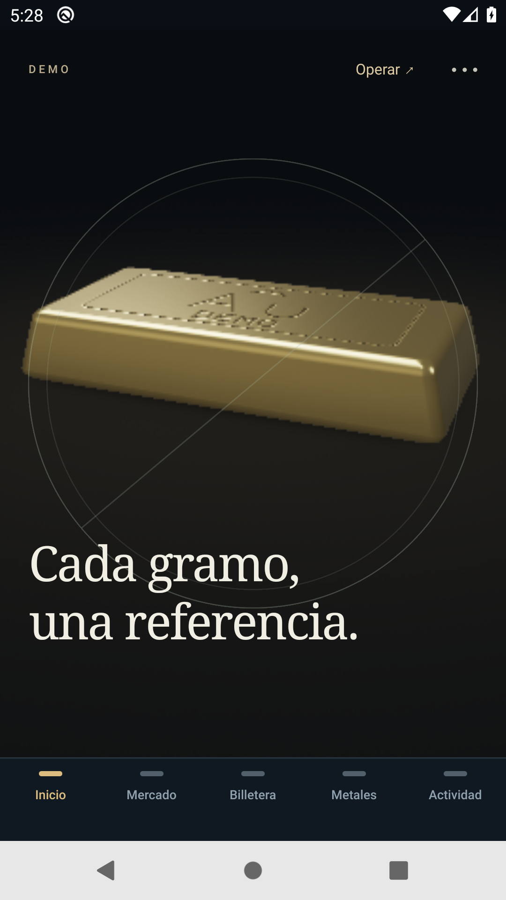 |

Las siete capturas nuevas reportaron GL equilibrado, sin ligero automático ni fallo interno, y se revisaron visualmente. Muestran geometría de túnel, paredes, vetas, salientes y transformación; son una condición distinta del vídeo adaptativo.

[Vídeo Android estable original](evidence/sprint-realism-20261101/android-r4-comparison/before-anonymous-scroll.mp4) · [Vídeo Android r4 adaptativo original](evidence/sprint-realism-20261101/android-r4-comparison/after-anonymous-scroll.mp4). Ambos muestran avance, retroceso hasta Origen y final Portafolio con CTA. El estable dura 37,984 s y cubre 96,55 % por PTS; r4 dura 35,405 s y cubre 95,39 %. Las muestras finales decodificadas y los endpoints muestran el final. **R4 pasa a ligero automático aproximadamente a los 10–11 s; no es una grabación 3D sostenida.** Los 128/158 frames codificados no equivalen a FPS de la app. Ambos grabadores acreditaron salida remota y cierre del host, sin terminación forzada; tardaron 569/299 ms. No se reparó ni remultiplexó ningún original.

| Perfil; p50 / p90 / p95 UI, ms | Estable 0.3.0 | Preview r4 | Estado final r4 |
| --- | --- | --- | --- |
| Inicio 3D, grabado | 200 / 650 / 700 | 150 / 200 / 200 | Ligero automático; 288 frames UI |
| Inicio 3D, sin grabar | 250 / 500 / 500 | 93 / 129 / 150 | Ligero automático; 370 frames UI |
| Ligero explícito | 57 / 77 / **85** | 93 / 121 / **133** | Ligero; 412 frames UI |

| Perfil | PSS estable antes→después, KiB | PSS r4 antes→después, KiB | Inicio Activity estable→r4, ms |
| --- | --- | --- | --- |
| Grabado | 120.020→120.945 | 128.369→134.544 | 1.408→1.234 |
| Sin grabar | 116.202→112.265 | 137.774→134.404 | 1.358→1.698 |
| Ligero explícito | 118.173→115.030 | 126.808→128.585 | 1.248→1.781 |

**Rendimiento no aceptado.** Los dos perfiles iniciados en 3D terminan con una calidad diferente a la referencia, que conserva GL: sus percentiles no prueban una mejora de velocidad 3D sostenida. El ligero empeora p95 de 85 a 133 ms y las tres muestras r4 tienen mayor PSS final. HWUI clasificó todos los frames UI nuevos medidos como janky; no mide los FPS de la superficie ExpoGL. Son una pasada por condición, con orden fijo y cachés/carga no controlados estadísticamente. PSS no es pico; Activity no es tiempo hasta datos o escena interactivos. No se midieron GPU móvil, temperatura, batería ni latencia táctil física. En ligero, el lingote puede cruzar el fondo del título final; texto y CTA siguen visibles y queda pendiente revisión visual en teléfono.

La comparación y el caso comercial son **dos jobs distintos sobre los mismos bytes de APK**, no una única aceptación de teléfono: 18 fases comparativas y 15 comerciales. El APK, certificado, paquete/código y registro EAS coinciden entre ambos. No se infiere causalidad del cambio de ciclo GL: también cambiaron el orden y la finalización del grabador. La aceptación física y el objetivo cercano a 60 FPS permanecen abiertos.

## Regresión comercial Android r4

El [caso comercial r4](https://github.com/Blaister9/Openminerals/actions/runs/41388807925/job/125095475432) aprobó **15/15 fases nativas** sobre el APK SHA-256 `adfbf909…1bf5`, fuente `ce9b79b`, arnés `fa308d0`. Verificó conversión USD→USDT, bloqueo por saldo insuficiente, compra de 2 g, venta de 0,5 g, reservas/cancelaciones de oferta y cotización de entrega, sobreasignación bloqueada, portafolio, siete operaciones e inmutabilidad del comprobante histórico. Antes del reinicio comprobó 1,5 g libres; después del inicio frío conservó 228,73 USDT. Son operaciones ficticias de una sesión legacy nueva, sin modificar el inventario compartido de la mina presentada.

También aprobó registro de comprador sin importar esa sesión, token de SecureStore tras inicio frío, logout y recuperación de los saldos legacy; login de operador público, Mina/Cuenta sin billetera de comprador, lectura del panel y logout. El UID y la versión de la instalación estable permanecieron iguales. [Resultados y hashes](evidence/sprint-realism-20261101/android-r4-commerce/provenance.json). No se publican capturas, credenciales ni datos privados de estas fases. La repetición nativa de la misma clave idempotente, marketplace entre cuentas, custodia por lotes/certificados y ciclo completo de entrega siguen sin ejecutarse con esta APK; las pruebas API/dominio cubren sus contratos sin cambios.

El workflow inicial en conjunto **falló en la comparación**, antes de instalar r4: el vídeo del APK estable carecía de `moov` y falló la captura final. No acredita ni rechaza el renderer r4. [Intento de referencia conservado](evidence/sprint-realism-20261101/failed-r4-reference-capture/provenance.json). Los eventos prueban una ventana de 8,010 s después de SIGINT; no prueban que se ejecutara el SIGKILL local ni que causara el archivo incompleto. El arnés ahora distingue errores de consulta y ausencia real del grabador, y espera hasta 30 s a salida Android más cierre anfitrión. Esa espera se registra fuera de la traza de entrada.

La repetición [41391258031](https://github.com/Blaister9/Openminerals/actions/runs/41391258031), arnés `8c4361d`, selecciona únicamente `comparison` mediante una lista cerrada validada. El APK, hash y fuente son idénticos al caso comercial aprobado; su referencia queda explícita en el manifest. Esto evita repetir comercio cuando solo cambia el cierre del grabador. Para una APK distinta se ejecutan de nuevo ambos casos. Ese intento volvió a fallar antes de instalar r4, durante la comprobación de bundle de la referencia estable. Se agotaron 420 s de Maestro sin identificar un selector o comando. No hubo nueva traza ni grabación y no se ejercitó el cierre endurecido. [Originales del segundo fallo de referencia](evidence/sprint-realism-20261101/failed-r4-reference-startup/provenance.json).

La comparación [41393661195](https://github.com/Blaister9/Openminerals/actions/runs/41393661195), arnés `907ccc9`, ejecuta ahora primero r4 y luego la referencia, conservando todos los perfiles y comprobaciones. La app estable se instala antes para tomar UID/versión, pero no se abre hasta concluir la candidata. El nuevo orden se registra explícitamente, sin contrabalanceo: calentamiento, cachés y carga pueden favorecer o perjudicar a la referencia posterior. El run finalmente aprobó las 18 fases; la sección de comparación r4 anterior registra los resultados y sus límites. Los fallos anteriores permanecen conservados.

## Incidencias Android r3 y revisión r4

La [comparación r3 `41384249997`](https://github.com/Blaister9/Openminerals/actions/runs/41384249997/job/125081455012) aprobó **11 fases**, incluidas las siete capturas GL equilibradas y el perfil ligero. Falló la cobertura del vídeo: 15 gestos durante 34,21 s produjeron un clip de 5,76 s y cinco frames, sin avance visual desde Origen. La cobertura PTS fue 11,57 %. El estado declaraba ligero automático, sin códigos de fallo interno. No se acepta ese clip como recorrido nuevo ni su métrica grabada. El perfil ligero válido mostró p95 UI 81→105 ms y mayor PSS final de la preview: estable→r3, 117.281→132.979 KiB. [Originales y revisión](evidence/sprint-realism-20261101/failed-r3-comparison/provenance.json).

El segundo [caso comercial r3](https://github.com/Blaister9/Openminerals/actions/runs/41385054878/job/125087999390) confirmó la conversión a 450 USDT y el bloqueo de la compra excesiva. Falló al buscar hacia abajo un campo situado encima del botón; no alcanzó compra, venta ni cuentas completas. Se corrigió únicamente esa segunda búsqueda a `UP`. [Fallo y diagnóstico estático](evidence/sprint-realism-20261101/failed-r3-commerce-scroll/provenance.json). La comparación duplicada del mismo APK se canceló después de conservar ese caso, al quedar sustituida por r4; no se acredita como resultado aprobado. [Registro de cancelación](evidence/sprint-realism-20261101/failed-r3-commerce-scroll/cancelled-comparison-context.json).

R4 separa la superficie nativa de la habilitación del dibujo: conserva contexto y renderer bajo la cobertura en ligero/reducido, sin RAF durante la pausa, y redibuja con progreso/material actuales al volver. Reduce el lado máximo del renderizador de software explícito a 384; hardware conserva hasta 1024 y pasa de presupuesto 60 a 30 sin sustituir la superficie al equilibrar. Navegación, fondo, cambio de tamaño, fallo y reintento todavía pueden destruir/recrear el contexto. La finalización de la cola ExpoGL no confirma `eglSwapBuffers`; desmontar durante presentación es una hipótesis compatible con las fuentes, **no una causa demostrada**. La revisión completó el contraste nativo descrito arriba; conserva un coste de memoria durante pausa y la causa histórica sigue sin aislarse.

El [benchmark de resolución de escritorio](evidence/sprint-realism-20261101/software-resolution/provenance.json) ejecutó 18 poses, 18 dibujos de calentamiento y 90 medidos por resolución sobre Chrome/SwiftShader. Con `gl.finish` más lectura RGBA, medianas 11,9 / 5,0 / 3,5 ms para lados 640 / 384 / 320; p95 de túnel 22,1 / 9,0 / 6,7 ms. Incluye transferencia de píxeles y excluye compilación. El piloto con solo `finish` produjo tiempos no creíbles y se excluyó de decisiones. A 384 se conservó más detalle que a 320, con 64 % menos píxeles que 640. **No son FPS Android** ni prueba de resolución del bloqueo. Se preservan originales, capturas y una reproducción separada.

Para repetirlo desde la raíz, configurar `OPENMINERALS_WEBGL_BROWSER` con la ruta a Chrome/Chromium y ejecutar `node mobile/scripts/benchmark-geology-resolution.mjs`; elige un directorio nuevo bajo `artifacts/` y nunca reemplaza evidencia anterior. Los seis módulos fuente del renderer se conservan con hashes; sus contenidos no cambian en r4.

## Comparación Android r2 y límites observados

El [run41377075737](https://github.com/Blaister9/Openminerals/actions/runs/41377075737) aprobó **13 fases nativas**: identidad/coexistencia de APK, siete capítulos de ambas versiones, las tres mediciones de cada APK y reanudación de la estable. **El workflow completo falló después** al esperar GL listo en una preparación redundante antes de movimiento reducido. No hay evidencia para atribuir ese fallo únicamente a auto-ligero, renderer, compositor o proceso. [Revisión y hashes](evidence/sprint-realism-20261101/android-r2-comparison/provenance.json).

La [regresión dirigida r2](https://github.com/Blaister9/Openminerals/actions/runs/41380976770) aprobó **cinco fases**, incluidas GL inicial, movimiento reducido y salidas comerciales. Falló preparando el capítulo 4 antes de enviar HOME: la vista pasó a ligero sin motivo automático, manual ni reducido. No alcanzó comercio, autenticación ni persistencia de la candidata. Se conserva el [fallo de reentrada y sus originales](evidence/sprint-realism-20261101/failed-r2-reentry/provenance.json); la revisión r4 completó después las 18 fases comparativas, sin aceptar aquel estado inexplicado como degradación por rendimiento. Las operaciones autenticadas y pruebas físicas pendientes se distinguen arriba.

[Vídeo Android anterior](evidence/sprint-realism-20261101/android-r2-comparison/before-anonymous-scroll.mp4) · [Vídeo Android r2 adaptativo](evidence/sprint-realism-20261101/android-r2-comparison/after-anonymous-scroll.mp4). Ambos muestran avance, retroceso y final Portafolio: 35,51 s/96,27% de cobertura PTS en el anterior y 30,87 s/89,85% en r2. Se revisaron la línea temporal, las muestras decodificadas finales y las capturas de extremo. El vídeo r2 cambia pronto a **fallback 2D automático**; no se presenta como un vídeo 3D completo ni como prueba de fluidez física.

| Perfil; p50 / p90 / p95 UI en ms | Estable 0.3.0 | Preview r2 | Condición r2 |
| --- | --- | --- | --- |
| Grabado | 150 / 400 / 400 | 89 / 133 / 150 | Termina en ligero automático; 390 frames UI |
| Sin grabar | 150 / 300 / 300 | 93 / 200 / **1.150** | Termina en ligero automático; solo **17 frames UI** |
| Ligero explícito | 44 / 61 / 69 | 48 / 73 / **81** | Ligero desde la preparación; 715 frames UI |

| Perfil | PSS estable antes→después, KiB | PSS r2 antes→después, KiB | Inicio Activity estable→r2, ms |
| --- | --- | --- | --- |
| Grabado | 118.849→116.939 | 134.523→130.505 | 1.264→1.132 |
| Sin grabar | 114.726→115.335 | 135.951→133.635 | 1.070→1.026 |
| Ligero explícito | 119.110→115.706 | 132.510→128.292 | 1.188→1.069 |

Las tres muestras r2 tienen mayor PSS observado; el ligero muestra p95 69→81 ms y el perfil sin grabar contiene una cola lenta con muestra pequeña. **Rendimiento no aceptado.** Son observaciones de una pasada por condición sobre el mismo emulador/host, sin contrabalancear orden ni repeticiones estadísticas. La calidad adaptativa y la resolución difieren entre versiones; no aíslan la velocidad del renderer a calidad fija. HWUI y cuadros VFR codificados no son FPS GPU, PSS no es pico y Activity no es tiempo hasta datos interactivos. No se midieron batería, temperatura o latencia táctil física.

La [PR #11](https://github.com/Blaister9/Openminerals/pull/11) conserva estos cambios sin integrarlos en `main`. La primera comparación [41372555065](https://github.com/Blaister9/Openminerals/actions/runs/41372555065) **falló: nueve fases aprobadas y una fallida**. R1 alcanzó los siete capítulos y la traza por accesibilidad, pero su vídeo solo cubrió 9,30 s de 37,97 s y terminó en refinación. El p95 UI registrado fue 900 ms frente a 650 de la referencia; no son una comparación válida de recorridos renderizados completos. Los 61 ms de inicio r1 tampoco se aceptan sin prueba de proceso frío. Se conserva la [revisión del fallo](evidence/sprint-realism-20261101/failed-r1/review.json) y el clip incompleto; la causa no queda aislada entre render, compositor, grabación o proceso. R2 contrasta la hipótesis de acumulación nativa mediante la barrera y un protocolo que verifica PIDs, cobertura temporal y muestras visuales finales. El primer intento r2 [41376893550](https://github.com/Blaister9/Openminerals/actions/runs/41376893550) terminó antes de instalar APK porque faltaba `ffprobe`; no fue un resultado de la app. El workflow instala ahora `ffmpeg/ffprobe` desde Ubuntu antes de validarlos. La comparación r2 se ejecutó y falló en [41377075737](https://github.com/Blaister9/Openminerals/actions/runs/41377075737). Las [instrucciones de QA](24-qa-android-mine-preview.md) fijan los hashes, la traza, las fases anónimas y el límite de credenciales. **60 FPS y aceptación física siguen pendientes.** La app y API siguen exclusivamente en modo DEMO; no hay cambios de contratos, PostgreSQL, saldos, permisos u operaciones financieras reales.

## Entrega y siguiente bloqueo

Clon local: `C:\Users\santi\Documents\Openminerals`. Remoto: [Blaister9/Openminerals](https://github.com/Blaister9/Openminerals.git). Rama: `codex/android-mine-realism-20261101`; [PR #11 en borrador](https://github.com/Blaister9/Openminerals/pull/11). Fuente de APK: `ce9b79b5abbe0389e5f2661dda0d7abc6b53bc14`; fuente de verificación final: `907ccc9a29d2c560697d36a1c3a00358260ab7ba`. La última actualización de documentación/evidencia no modifica esas fuentes. El archivo local previo `docs/22-entrega-android-030.md` se conserva sin tocar ni incorporar.

Abrir [la APK r4](https://github.com/Blaister9/Openminerals/releases/download/android-mine-preview-0.4.0-r4-20261101/Openminerals-Mina-Preview-0.4.0-r4-android.apk) desde Android, permitir su instalación cuando el sistema lo solicite y abrir **Openminerals Mina Preview**. Mantener instalada Openminerals Demo. No requiere configurar secretos nuevos. El [acceso público de operador DEMO autorizado](https://github.com/Blaister9/Openminerals/blob/main/demo-access/operator-public.json) sirve para la mina compartida ficticia; las credenciales de compradores permanecen privadas.

Railway conserva proyecto `openminerals-demo`, entorno `demo`, servicio `openminerals-api` y [API HTTPS](https://openminerals-api-demo.up.railway.app/health), modo `postgres-demo`. No se cambiaron infraestructura, contratos o despliegue ni se ejecutó SQL administrativo. Los registros DEMO nuevos de QA se crearon mediante la API existente. El siguiente bloqueo de aceptación es probar r4 en teléfono Android y medir su presentación/GPU con calidad declarada; también faltan fixtures aisladas para los recorridos nativos autenticados completos. Android exclusivamente; iOS queda fuera de este encargo.
