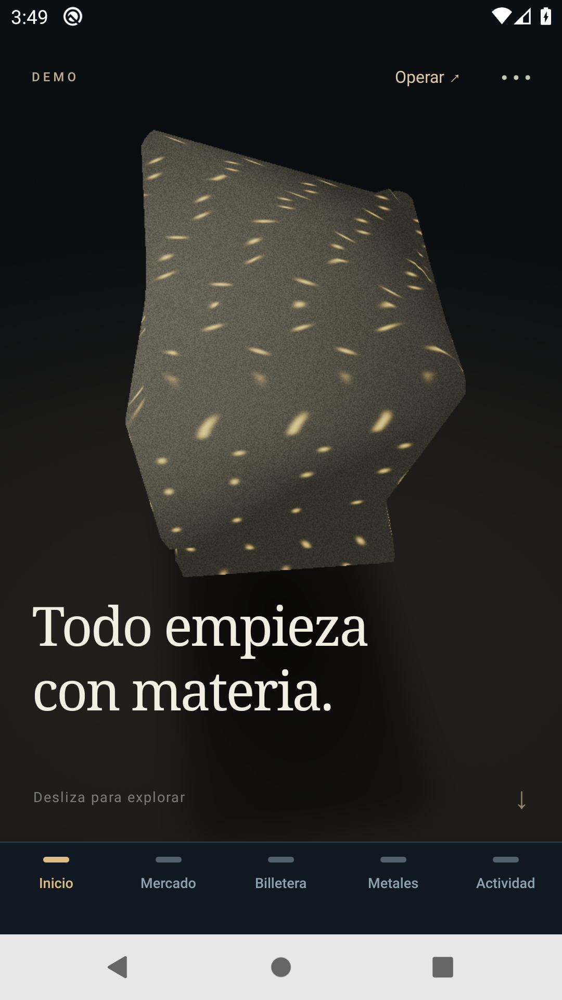
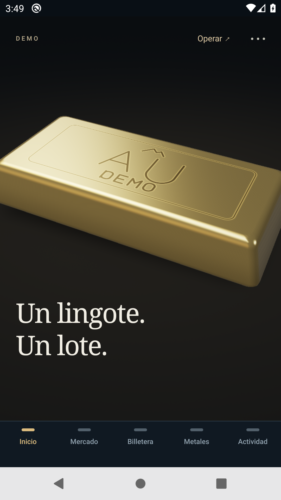
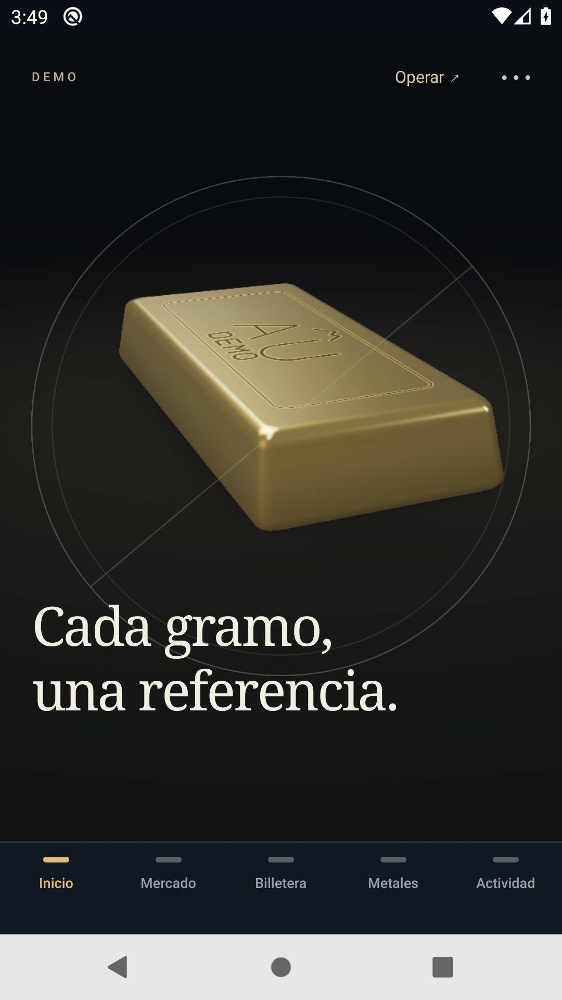
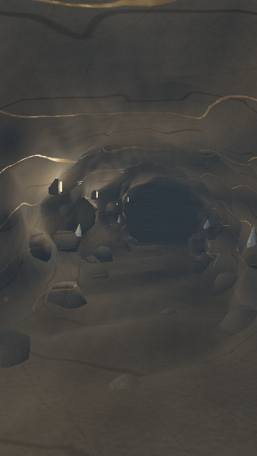
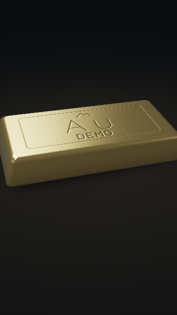
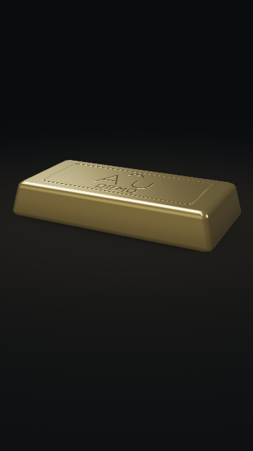

# Realismo minero Android · sprint del 1 de noviembre de 2026

**En desarrollo. Todo es DEMO.** La candidata de este sprint se instala como aplicación Android independiente para conservar la entrega comercial. No hay aceptación física ni rendimiento a 60 FPS acreditados. El informe se ampliará con la fuente final, regresión, métricas y evidencia comparativa nueva.

## Entrega conservada

La base es `main@ed87d2ea233227437ab5f5cc2eb0900674e1231f`. El APK Android 0.3.0/código 6 procede de `eae7f6ad57f5a667c2bf40775a4cb30f1c0dd8b6`: las diferencias posteriores son del arnés de aceptación. [CI de fuentes](https://github.com/Blaister9/Openminerals/actions/runs/41218118564) y [aceptación en emulador](https://github.com/Blaister9/Openminerals/actions/runs/41218121238) aprobaron; esta última incluye comercio, actualización de comprador/operador y cuentas/billeteras. Los artefactos descargables del run ya no estaban disponibles al auditarlo. Esto no acredita aceptación en teléfono.

El [APK 0.3.0 existente](https://expo.dev/artifacts/eas/zzjf0770cQWD12A6J-ly7cuCyZfpwrKet8sKRaWJDZQ.apk), [build EAS `ea0349a4`](https://expo.dev/accounts/chipirips-team/projects/openminerals-demo/builds/ea0349a4-7b55-4808-a332-be290d1a9b9e), conserva paquete `com.openminerals.demo.mobile`, runtime `0.3.0`, canal `demo` y SHA-256 `d99e8af9617f56d7862a849ebd057025cb9d6adc164b97496a5532f7b29ad29e`. No existe una release GitHub 0.3.0 al comenzar este sprint. La [release publicada con APK](https://github.com/Blaister9/Openminerals/releases/tag/v0.2.0-demo) sigue siendo 0.2.0, SHA-256 `c35719bf44fdc5a1237249be7e80d6d3102e57ee58f0cd0d9b5af3c66f32d83f`; la RC posterior remite al mismo binario. No se reemplazan sus archivos ni tags. [Manifest de preservación](evidence/sprint-realism-20261101/stable-release.json).

La [PR geológica #8](https://github.com/Blaister9/Openminerals/pull/8), cabeza `80da7c8`, conserva una implementación y evidencia histórica del 30 de octubre. Se adaptan selectivamente sus módulos gráficos sobre la base comercial actual; no se mezcla su rama ni se incorporan sus contratos o cambios de API. Sus métricas y vídeos pertenecen a Android 0.2.0 y no se atribuyen al nuevo binario.

## Candidata Android aislada

Rama: `codex/android-mine-realism-20261101`. `mobile/app.json` conserva el registro estable; `mobile/app.config.js` resuelve siempre la candidata, también en desarrollo local. Identidad: **Openminerals Mina Preview**, paquete `com.openminerals.demo.minepreview`, versión/runtime `0.4.0`, código 1, esquema `openminerals-mine-preview`, canal `mine-realism`. El perfil EAS `mine-realism` utiliza entorno `preview`, APK interno y la misma API DEMO HTTPS.

Se mantienen proyecto EAS, ExpoGL, dependencias y configuración de recuperación embebida. El runtime distinto impide que la candidata se aplique a los APK estables; el canal propio y su cabecera separan además las solicitudes. La configuración rechaza perfiles EAS antiguos, compilación sin el opt-in `OPENMINERALS_MINE_PREVIEW=1` y plataforma iOS. Los perfiles anteriores permanecen como procedencia; para reconstruir la entrega estable se usa su commit congelado.

La instalación paralela conserva la app comercial y sus datos en su propio almacenamiento. La preview comienza con una sesión local nueva; no importa automáticamente SecureStore, saldos ni pendientes de la instalación estable. Una cuenta DEMO existente puede abrirse explícitamente en la preview y sigue viendo su mismo estado de backend. Para QA comercial se utilizarán cuentas/minas aisladas; ninguna medición visual necesita modificar la mina presentada.

Desde `mobile`, `npx eas-cli build --platform android --profile mine-realism` compila la candidata; el perfil contiene el opt-in. El [build EAS `8b45cf14`](https://expo.dev/accounts/chipirips-team/projects/openminerals-demo/builds/8b45cf14-4f36-4504-ac7b-22f4a6f6ef16) terminó el **1/11/2026 a las 20:24:23 de Bogotá**, fuente gráfica `31e62ae4e3073d643b9901543808539573bea484`. El primer build `f1d5867d` se canceló antes de distribuirlo para incorporar la corrección de cadencia. EAS creó una firma propia para el paquete paralelo y el canal `mine-realism`; no se publica una OTA sobre `demo`.

[Descargar APK Mina Preview 0.4.0](https://github.com/Blaister9/Openminerals/releases/download/android-mine-preview-0.4.0-20261101/Openminerals-Mina-Preview-0.4.0-android.apk) · [prerelease independiente](https://github.com/Blaister9/Openminerals/releases/tag/android-mine-preview-0.4.0-20261101). APK: **77.357.880 bytes**, SHA-256 `ad4a01ecca69a4c2e5d6ec24e7c6eca388ee5216844dc6e6314fe8335af26d32`; certificado `86c84db35e91b187f3f818c0cc74ddb91df9a95014cba138ac7e04611957aa09`. `apksigner` y la inspección de manifiesto/bundle aprobaron paquete, versión/código/runtime/canal, ABIs, ausencia de `debuggable`, recuperación embebida y API HTTPS. El certificado se obtiene del artefacto EAS descargado y se fija para cotejarlo en CI; no se afirma consultar independientemente el almacén de credenciales. [Registro público del build](evidence/sprint-realism-20261101/candidate-build.json).

Instalar **Mina Preview** junto a Openminerals Demo, sin desinstalar ni borrar datos de esta última. La copia `Presented-Openminerals-Demo-0.3.0-android.apk` de la prerelease sirve de referencia exacta para CI, no es la experiencia nueva. Puede abrirse explícitamente una cuenta DEMO en Preview; su sesión local inicial es independiente. No resolver un pendiente de la app estable cambiando de cuenta o reinstalando.

## Escena y continuidad

La escena pasa de un espécimen flotante a una galería ficticia de más de 40 unidades de profundidad, con techo, paredes y suelo desplazados, normales de superficie, salientes y rocas irregulares, cuarzo opaco y luminarias. Las vetas se evalúan sobre las coordenadas tridimensionales de las paredes. Se utilizan buffers estáticos, ExpoGL y shaders propios; no hay bibliotecas gráficas, SDK ni módulos nativos nuevos.

El túnel emplea BRDF Cook–Torrance con GGX, visibilidad Smith y Fresnel Schlick, rugosidad/metallicidad y energía difusa reducida en las vetas. Dos volúmenes elipsoidales aproximan las sombras de los salientes frente a cuatro luces acotadas. No son mapas de sombras de toda la geometría ni iluminación global. AO de cavidades, niebla y 48 partículas pequeñas completan la atmósfera; su posición sigue el desplazamiento, sin bucle de animación en reposo.

Se conserva el orden y los accesos de los siete capítulos: origen → extracción → refinación → lingote → custodia virtual → fraccionamiento → portafolio. La cámara recorre la galería y el espécimen avanza al primer plano mientras el túnel se disuelve; la geometría se transforma hasta el lingote. Las mismas funciones de progreso se evalúan al retroceder. La selección de Au/Ag/Pt/Pd es estado local de la representación: **no cambia el metal elegido en Mercado**, saldos, permisos ni envía operaciones. `App.tsx`, componentes comerciales, `api/`, dependencias y locks permanecen idénticos a la base.

El scheduler dibuja por demanda con presupuesto inicial de 60 cuadros/s, sin atribuir ese objetivo a FPS medidos. Tras 45 muestras de envío lento pasa a 30 y al 75% de resolución; si el coste sigue alto puede ofrecer la vista ligera. Ese coste es tiempo síncrono de envío JS/GL, **no duración GPU**. El modo ligero usa un bitmap precalculado de 360×640, 314.992 bytes, más el lingote simplificado; movimiento reducido y lector de pantalla evitan el movimiento de cámara/GL. La muestra ligera anterior de PR #8 tenía una regresión: no se supone corregida por equivalencia.

## Validación y pendientes

Las pruebas nuevas de configuración ejecutan el resolvedor real para comprobar identidad local/build equivalente, canal/runtime distintos, preservación de `app.json`, rechazo de perfiles antiguos/opt-in ausente/iOS y URL API HTTPS sin secretos. El 1/11 aprobaron **15/15 pruebas dirigidas**: cuatro nuevas de preview y once existentes de entrega, mediante `node --experimental-strip-types --test test/mine-preview-config.test.mjs test/android-release.test.mjs` desde `mobile`. `npx expo config --type public --json` resolvió la identidad aislada y `git diff --check` aprobó. Estas pruebas no ejecutan Android ni acreditan una compilación nueva.

La validación inicial sobre `ed87d2e` aprobó **91 casos API en memoria y 80 sobre PostgreSQL 17.4 local desechable**, smoke local y **252 pruebas móviles**, con dos GL opcionales omitidas. TypeScript, compatibilidad Expo, parche de toolchain y Doctor 21/21 aprobaron. [Resultados iniciales](evidence/sprint-realism-20261101/initial-validation.json). No se reinició ni modificó Railway/PostgreSQL compartido.

La suite final local aprobó **317/317 pruebas móviles**, con Chrome/SwiftShader habilitado y cero omisiones. Incluyen 18 poses del renderer compuesto, reversibilidad exacta, opacidad de la composición, cuatro materiales/estampados, liberación de buffers/programas, recuperación de contextos obsoletos, adaptación real del componente y controles del nuevo harness. El [reporte de software](evidence/sprint-realism-20261101/software/report.json) identifica su entorno de escritorio; no acredita Android. La prueba de iluminación ejecuta 12 comparaciones con/sin sombras y 288 sondas GLSL finitas, incluso con vectores opuestos. El export Hermes Android también terminó con la API pública HTTPS. [Validación gráfica](evidence/sprint-realism-20261101/visual-validation.json).

La simulación del scheduler encontró y corrigió una pérdida de cadencia: el límite de 60 producía 45 dibujos/s a 90 Hz, y el de 30 podía caer a 20,5–26,6. El acumulador de plazos alcanza promedios de 60 y 30 con relojes controlados de 60/90/120 Hz y evita ráfagas tras pausas. Esto verifica el planificador, **no FPS reales de GPU o teléfono**. La escena expone su nivel de calidad para registrar si la medición observa calidad alta, equilibrada o vista ligera.

| Evidencia | Origen mineral | Lingote | Custodia |
| --- | --- | --- | --- |
| APK estable 0.3.0, Android CI histórico |  |  |  |
| Renderer nuevo, **software de escritorio**, sin UI |  |  |  |

La segunda fila no se presenta como captura Android. El [vídeo estable original](evidence/sprint-realism-20261101/baseline/stable-030-tour.mp4), sus hashes y la [procedencia](evidence/sprint-realism-20261101/baseline/provenance.json) se conservan. La muestra histórica mide p50/p90/p95 UI 200/500/550 ms; no es una comparación controlada contra la candidata. El AVD local quedó `unauthorized` antes de ejecutar apps; no se automatizó la autorización, instaló software ni borraron datos. [Limitación local](evidence/sprint-realism-20261101/baseline/local-emulator-attempt.json).

Falta incorporar el resultado del build, la comparación antes/después en el mismo emulador, capturas/vídeos Android nuevos y regresión nativa. **60 FPS y aceptación física siguen pendientes.** La app y API siguen exclusivamente en modo DEMO; no hay cambios de contratos, PostgreSQL, saldos, permisos u operaciones financieras reales.
